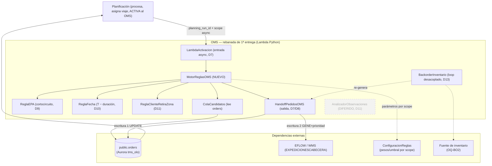

# Catálogo de componentes — Módulo OMS (rebanada delgada de 1ª entrega)

> Intent: `260826-modulo-oms`. Etapa: Domain Design (Inception, **re-corrida v4 por
> reuniones de negocio — inversión del flujo OMS↔Planificación, 2026-10-16**).
> Lead: arquitecto; apoyo: plataforma AWS, diseño. Deriva de `requirements.md` v4
> y `stories.md` v4 y de `project.md` (`## Decided`).
>
> **Nomenclatura (vigente)**: WMS = **EFLOW**; módulo que asigna la prioridad de
> EPA (1 o 2) = **EPRAC**. (No "IPRAC"/"IFLOW".)
>
> **Correcciones de esta re-corrida v4 (D7–D13), SUPERSEDE del modelo D6:**
> - **Flujo invertido (D7)**: Planificación procesa, asigna viaje y **activa al
>   OMS** por una **lambda de activación asíncrona** (nuevo componente
>   `LambdaActivacion`). El OMS **lee de `public.orders`** (no de
>   `EXPEDICIONESCABECERA`).
> - **Escritura real a EFLOW (D8)**: `HandoffPedidosOMS` hace escritura 1 = UPDATE
>   a `public.orders`, escritura 2 = **EFLOW real** (`TPEXSI='GENE'` + `PRIORIDAD`,
>   flag TRUE). **No** escribe el número de viaje. **No existe `oms.pedidos`**
>   (esquema único `public`, BD 2026-10-16).
> - **EPA (D9)**: nuevo componente/regla **`ReglaEPA`** que **cortocircuita** el
>   score (prioridad pre-asignada por EPRAC: 1 o 2).
> - **Regla fecha generalizada (D10)**: `ReglaFecha` = `fecha_entrega − duración`,
>   con **duración como insumo de Planificación** (no parámetro fijo).
> - **cliente retira = zona (D11)**: `AnalizadorObservaciones` **diferido a
>   futuro**; nueva **`ReglaClienteRetiraZona`** (por `delivery_zone`).
> - **Backorder (D13)**: nuevo componente **`BackorderInventario`**, loop propio
>   **desacoplado** de la corrida.
>
> **ALCANCE ACOTADO (decisión de secuencia del usuario)**: esta corrida detalla
> **solo los 5 componentes de la rebanada delgada de 1ª entrega** (motor propio
> del OMS + 2 reglas + lectura de cola + handoff de dos escrituras), para que
> Code Generation arranque por el **esqueleto del `MotorReglasOMS` en Lambda**. El
> resto del OMS queda **DIFERIDO** (listado abajo, no eliminado). `CalendarioRutas`
> queda **ELIMINADO** (D5). La captura de entidades es a nivel propiedad+forma; el
> esquema completo es de Functional Design.
>
> **Invariantes firmes** (project.md): el OMS lee del WMS/EFLOW; **no escribe
> fechas**; prioridad numérica invertida (menor = más urgente; **cómo se numera lo
> decide una estrategia elegida por scope** — `escala_lineal` = score ponderado,
> default; `dias_hasta_salida` = Cofersa, `0..n` días hasta la salida, 0 = liberado,
> nunca en la cola; v4.2/ADR-014); motor de reglas
> **propio del OMS, nuevo, en Lambda Python** (C2-RESUELTO: no portar AST, no
> motor compartido, no tocar Liquidaciones); multi-compañía **por scope**
> CUSTOMER→WAREHOUSE→COUNTRY→GLOBAL (C3-SUPERSEDE, no Lambda por compañía);
> **flujo invertido** (D7: Planificación activa al OMS vía LambdaActivacion async;
> el OMS lee de `public.orders`); **dos escrituras** en el handoff (D7/D8: UPDATE a
> `public.orders` + EFLOW real `TPEXSI='GENE'`+`PRIORIDAD`; **no** hay `oms.pedidos`,
> esquema único `public`); el viaje lo arma Planificación ANTES de activar al OMS;
> el OMS **no** escribe el número de viaje.

## Parte A — Catálogo (fuente de verdad)

```yaml
components:
  - name: MotorReglasOMS
    summary: Motor de reglas propio del OMS (NUEVO, Lambda Python) que orquesta la corrida de priorización.
    behaviour: >
      Núcleo automático del OMS (FR2, FR3, FR6, NFR1), construido NUEVO y propio
      del OMS en Lambda Python (C2-RESUELTO: no se porta el AST de
      src/lib/tarifas/, no se comparte motor con el TMS, no se toca Liquidaciones;
      OMS y TMS son módulos separados que se comunican). **Lo ACTIVA
      LambdaActivacion** (D7: Planificación lo dispara tras asignar viaje; ya NO
      cron/EventBridge). Por cada corrida: toma los candidatos de ColaCandidatos
      (leídos de `public.orders`), resuelve las reglas aplicables POR SCOPE
      (CUSTOMER→WAREHOUSE→COUNTRY→GLOBAL, la más específica gana). **Deriva los
      pedidos EPA a ReglaEPA** (D9: EPA cortocircuita fecha/score, prioridad
      pre-asignada por EPRAC). Para Cofersa/mayoreo invoca las reglas ejecutables
      (ReglaFecha generalizada T−duración, ReglaClienteRetiraZona por zona),
      calcula el SCORE PONDERADO (submódulo puro: suma de pesos), y convierte el
      resultado en la prioridad numérica INVERTIDA (menor=más urgente, desempate
      estable fecha→hora→id) con la ESTRATEGIA de numeración de la compañía
      (submódulo puro **EstrategiasPrioridad**, `estrategias_prioridad.py`, elegida
      por `config.estrategia` del scope: `escala_lineal` default = mapa del score a
      [1, escala_prioridad]; `dias_hasta_salida` = Cofersa, días hasta la salida con
      `ancla_fecha`/`prioridad_piso`; nombre desconocido → default; v4.2/ADR-014),
      aplica el UMBRAL DE INYECCIÓN (FR3.4/NFR4) y ordena a HandoffPedidosOMS generar
      los que pasan. Aplica el EFECTO "cliente retira" (prioridad máxima DE LA COLA =
      piso de cola, nunca 0; + agrupación).
      **AnalizadorObservaciones queda FUERA de la ruta activa (diferido, D11).** NO
      escribe fechas. NO escribe el número de viaje. NO arma viajes (eso es de
      Planificación). El cálculo de score se mantiene como submódulo PURO testeable
      (regla Testing Posture).
    responsibilities:
      - Ser activado por LambdaActivacion y orquestar la corrida del lote/scope
      - Derivar los pedidos EPA a ReglaEPA (cortocircuito); el resto a fecha/zona/score
      - Calcular el score ponderado (submódulo puro)
      - Numerar la prioridad con la estrategia del scope (submódulo puro EstrategiasPrioridad, ADR-014)
      - Aplicar el umbral de inyección (corte por capacidad)
      - Aplicar el efecto "cliente retira" (piso de cola + agrupación)
      - Ordenar el handoff (UPDATE orders + escritura EFLOW) de los pedidos que pasan
    depends_on:
      - component: ColaCandidatos
        interaction: obtiene los pedidos candidatos del lote/scope (de public.orders)
        style: sync
      - component: ReglaEPA
        interaction: deriva los pedidos EPA (cortocircuita fecha/score; prioridad pre-asignada)
        style: sync
      - component: ReglaFecha
        interaction: evalúa fecha_entrega − duración (Cofersa/mayoreo; duración = insumo de Planificación)
        style: sync
      - component: ReglaClienteRetiraZona
        interaction: detecta cliente-retira por delivery_zone (prioridad máxima de la cola = piso de cola)
        style: sync
      - component: HandoffPedidosOMS
        interaction: ordena las dos escrituras (UPDATE orders + EFLOW GENE+prioridad) de los pedidos que pasan
        style: sync
    dependents:
      - component: LambdaActivacion
        interaction: lo activa con el lote/scope (planning_run_id + scope) de forma asíncrona
        style: async
    external_dependencies:
      - name: ConfiguracionReglas (parámetros por scope)
        kind: other
        purpose: >
          Pesos, umbral de inyección, PARÁMETROS DE RUTA (días de salida, horas de
          corte, duración estimada) y ESTRATEGIA DE PRIORIDAD (`estrategia`,
          `ancla_fecha`, `prioridad_piso` en `oms_rule_configs`, `sql/55`; ADR-014)
          resueltos POR SCOPE (CUSTOMER→WAREHOUSE→COUNTRY→GLOBAL). En la rebanada se consumen como configuración/parámetros del
          motor (no hay componente CatalogoReglas-UI todavía — DIFERIDO); su edición
          desde UI es trabajo posterior.
    entities:
      - name: RegistroPrioridad
        identifier: pedido+almacén+compañía+sucursal+corrida
        attributes: [pedido, almacén, compañía, país, sucursal, prioridad, score, tipoOrigen, umbralAplicado, corrida, clienteRetira, grupoViajeDummy]
        references:
          - entity: PedidoCandidato
            owned_by: ColaCandidatos
            relationship: cada RegistroPrioridad corresponde a un PedidoCandidato leído de la cola

  - name: ReglaFecha
    summary: Regla de fecha generalizada — fecha_listo = fecha_entrega − duración_logística (T-1 es el caso Cofersa).
    behaviour: >
      Regla ejecutable 1 (FR2/FR6.1). Usa como fecha base `delivery_date` (desde
      `public.orders`, poblada desde EFLOW `FECHAEXPEDICIONPLANIFICADA`; la fecha de
      entrega del cliente) — la lee como INSUMO y NO la modifica (invariante). **D10
      — regla generalizada**: `fecha_listo = fecha_de_entrega − duración_logística`.
      **T-1 es el caso particular** con duración = 1 (Cofersa CR). La
      **duración_logística es un INSUMO POR PEDIDO/VIAJE que entrega Planificación**
      (ya NO un parámetro fijo de config del OMS): Cofersa CR = 1 día; mayoreo VE =
      dinámica (días de rodada por clúster/distancia que calcula Planificación;
      rutas/duraciones VE pendientes con comercial). Default 1 día para Cofersa si
      Planificación no entrega valor. Ajusta por horas de corte. Aporta su peso al
      score. **NO aplica a EPA** (ReglaEPA cortocircuita). FALLBACK (US7/US8): como
      `delivery_date` puede venir con valor por defecto/centinela (Cofersa la llena
      por default), el disparador del fallback es "fecha = centinela/default", no
      "fecha nula". NO escribe nada (solo evalúa).
    responsibilities:
      - Evaluar fecha_listo = fecha_entrega − duración_logística (T-1 = caso Cofersa)
      - Tomar la duración logística como INSUMO de Planificación (no parámetro fijo); default 1 día Cofersa
      - Disparar el fallback ante fecha = centinela/default (no por NULL); no aplica a EPA
    depends_on: []
    dependents:
      - component: MotorReglasOMS
        interaction: el motor invoca la regla durante la corrida (Cofersa/mayoreo, no EPA)
        style: sync
    external_dependencies:
      - name: duración_logística (insumo por pedido/viaje de Planificación)
        kind: other
        purpose: días para fecha_listo; Cofersa=1, VE dinámica (de Planificación); reemplaza el parámetro fijo duracion_ruta_dias (D10)
    entities: []

  - name: ReglaEPA
    summary: Rama EPA que CORTOCIRCUITA el score — prioridad pre-asignada por EPRAC (NUEVO, D9).
    behaviour: >
      Regla ejecutable para pedidos de **EPA** (`customer_type = TIENDA`). D9: EPA
      **NO calcula** prioridad — **cortocircuita** el motor de fecha/score. **EPRAC**
      asigna la prioridad **1 o 2** aguas arriba (EFLOW); esos valores nunca cambian
      y EPA nunca usa 0. ReglaEPA **toma la prioridad que trae** (1 o 2) sin
      recalcular (`priorizar=false`). NO pasa por ReglaFecha ni por el score
      ponderado. El EFECTO (poner el pedido en `wms_situation = GENE` con esa
      prioridad) lo aplica el flujo normal de MotorReglasOMS→HandoffPedidosOMS. Es
      una regla/rama propia, no un caso del motor de fecha.
    responsibilities:
      - Detectar pedidos EPA (customer_type=TIENDA) y cortocircuitar fecha/score
      - Tomar la prioridad pre-asignada por EPRAC (1 o 2) sin recalcular
    depends_on: []
    dependents:
      - component: MotorReglasOMS
        interaction: el motor deriva los pedidos EPA a esta rama en vez de fecha/score
        style: sync
    external_dependencies:
      - name: EPRAC (módulo que pre-asigna la prioridad de EPA)
        kind: other
        purpose: origen de la prioridad pre-asignada (1 o 2); el OMS la respeta, no la recalcula
    entities: []

  - name: ReglaClienteRetiraZona
    summary: Detecta "cliente retira" por ZONA (delivery_zone) y lo prioriza al máximo (D11, reemplaza la vía por observaciones).
    behaviour: >
      Regla ejecutable (FR6.2). **D11**: "cliente retira" se identifica por la
      **zona** del pedido (`delivery_zone`), **NO** interpretando el texto de
      observaciones ni con IA. Un pedido cuya zona es la de "cliente retira" recibe
      la **prioridad más alta de la cola** (= piso de cola, 1 en Cofersa; nunca 0,
      que es "liberado" — ADR-014) y se agrupa en su viaje/cliente correspondiente.
      Determinista y testeable sin IA. El EFECTO (prioridad máxima vía peso +
      agrupación) lo aplica MotorReglasOMS.
    responsibilities:
      - Detectar cliente-retira por delivery_zone (no por observaciones)
      - Señalar prioridad máxima de la cola (piso de cola) + agrupación para esos pedidos
    depends_on: []
    dependents:
      - component: MotorReglasOMS
        interaction: el motor invoca la regla durante la corrida
        style: sync
    external_dependencies: []
    entities: []

  - name: AnalizadorObservaciones
    summary: (DIFERIDO A FUTURO — D11) Interpretaría observaciones con IA (Bedrock) para salidas futuras.
    behaviour: >
      **DIFERIDO A FUTURO (D11, 2026-10-16)**. Negocio decidió modelar "cliente
      retira" como ZONA (ver ReglaClienteRetiraZona), no interpretando observaciones.
      El análisis del texto libre de `observaciones` con un modelo de Amazon Bedrock
      **sale de esta entrega** y queda como requerimiento futuro para OTRAS salidas
      (cambio de dirección, cita, urgencia). NO se construye en la rebanada. Se
      conserva en el catálogo como componente futuro, sin dependientes activos.
    responsibilities:
      - (FUTURO) Clasificar observaciones con IA para salidas distintas de cliente-retira
    depends_on: []
    dependents: []
    external_dependencies:
      - name: Amazon Bedrock
        kind: third-party-api
        purpose: (futuro) clasificación del texto libre de observaciones; NO en esta entrega (D11)
    entities: []

  - name: BackorderInventario
    summary: Loop PROPIO y DESACOPLADO — re-genera las acciones omitidas por inventario cuando entra stock (NUEVO, D13).
    behaviour: >
      Nueva responsabilidad del OMS (FR6c/D13). Es un **loop/componente PROPIO
      DESACOPLADO** de la ruta de priorización: NO vive dentro del handoff de la
      corrida ni de la LambdaActivacion — es una **revisión continua / por evento**.
      Mecánica conceptual: (1) leer las **acciones liberadas que quedaron omitidas**
      por falta de inventario; (2) **chequear inventario**; (3) **re-mandar a generar
      solo esas acciones** (situación `GENE` con su prioridad) cuando entre stock.
      Reutiliza el borde de escritura (HandoffPedidosOMS) para re-generar. ALCANCE
      REBANADA: solo el ESQUELETO del componente + las open questions; el diseño fino
      NO se cierra. Open questions (hechos de integración/negocio, NO inventar):
      OQ-BO1 de dónde lee las acciones omitidas en EFLOW (tabla/estado); OQ-BO2 cuál
      es la fuente de inventario; OQ-BO3 el disparador del re-chequeo (evento de
      entrada de inventario vs. barrido periódico).
    responsibilities:
      - Leer las acciones liberadas omitidas por falta de inventario (backorder)
      - Chequear inventario y re-mandar a generar solo esas acciones cuando entre stock
      - Operar como loop desacoplado de la corrida (continuo/por evento), no en el handoff del lote
    depends_on:
      - component: HandoffPedidosOMS
        interaction: reutiliza la escritura para re-generar las acciones cuando entra stock
        style: sync
    dependents: []
    external_dependencies:
      - name: EFLOW (acciones omitidas) — tabla/estado OQ-BO1
        kind: database
        purpose: origen de las acciones liberadas omitidas por inventario (tabla/estado por confirmar, OQ-BO1)
      - name: Fuente de inventario — OQ-BO2
        kind: other
        purpose: inventario que el OMS consulta para decidir re-generar (por confirmar, OQ-BO2)
    entities: []

  - name: LambdaActivacion
    summary: Puerta de entrada ASÍNCRONA — Planificación activa al OMS sobre un lote ya procesado (NUEVO, D7/FR0).
    behaviour: >
      Nuevo borde de ENTRADA del flujo invertido (D7). CONTRATO RESUELTO con el
      dueño de Planificación (2026-10-16): mecanismo = **columna como fuente de
      verdad + lambda como SEÑAL** (no llaves en el payload). Planificación invoca
      esta lambda de forma ASÍNCRONA (event-driven, fire-and-forget) tras asignar
      los viajes; la señal PUEDE llevar IDs + `planning_run_id` para
      correlación/latencia, pero NO es la fuente de verdad del lote. La lambda solo
      ARRANCA la corrida (MotorReglasOMS); el conjunto de trabajo lo resuelve
      ColaCandidatos leyendo public.orders por la columna `oms_processed_at` (ver
      ColaCandidatos). RED DE SEGURIDAD: si la señal se pierde/reintenta, un barrido
      periódico sobre `oms_processed_at IS NULL` recupera el trabajo (idempotencia
      natural por columna, no por run_id). El OMS procesa por compañía (batching
      propio; Planificación no lo conoce).
    responsibilities:
      - Recibir la señal asíncrona de Planificación (arranca la corrida)
      - Arrancar MotorReglasOMS; el conjunto lo resuelve ColaCandidatos por columna
      - Soportar el barrido periódico como red de seguridad (idempotencia por oms_processed_at)
    depends_on:
      - component: MotorReglasOMS
        interaction: arranca la corrida; el lote se resuelve por lectura de orders (oms_processed_at)
        style: async
    dependents: []
    external_dependencies:
      - name: Planificación (otro módulo, emite la señal)
        kind: other
        purpose: avisa al OMS tras asignar viajes (señal, no fuente de verdad del lote). CONTRATO RESUELTO 2026-10-16: pull por columna oms_processed_at + lambda señal
    entities: []

  - name: ColaCandidatos
    summary: Lee de public.orders los pedidos del lote ya procesado por Planificación (borde de ENTRADA, adaptador de lectura).
    behaviour: >
      Encapsula el lado LECTURA del OMS (FR1). **CAMBIO D7**: ya NO lee de
      `EFLOW_OLO.dbo.EXPEDICIONESCABECERA` ni usa el anti-join con
      `ALMACENMOVIMIENTOS_CARCAM`. Resuelve la cola sobre **`public.orders`** (Aurora
      `tms_olo`) por **POLLING DE COLUMNA** (contrato CERRADO 2026-10-16, ADR-007):
      **`planning_run_id IS NOT NULL AND oms_processed_at IS NULL`** — pedidos que
      Planificación ya procesó y dejó pendientes de priorizar. La **columna es la
      única fuente de verdad** (activación v1 = polling; EventBridge = futuro). El
      OMS ordena/batcha el conjunto NULL por compañía. Expone los insumos desde
      `orders`: `delivery_date`, `lead_time_days` (duración logística DINÁMICA que
      entrega Planificación por pedido — puede venir NULL → default 1 día, D10),
      `observaciones`, `delivery_zone` (base de cliente-retira, D11), `customer_type`
      (TIENDA/MAYOREO para separar EPA de Cofersa/mayoreo), `numero_viaje` (formato
      YYYYMMDD-NNN; lo escribe Planificación), `planning_run_id`, y la llave EFLOW
      (`eflow_id_almacen/compania/sucursal/expedicion`). Aísla el acceso a `orders`
      del dominio del OMS. (`wms_trip_number` queda ELIMINADA del contrato — ADR-0004
      de Planificación; el número de viaje es `numero_viaje`.)
    responsibilities:
      - Resolver la cola por polling de public.orders: planning_run_id IS NOT NULL AND oms_processed_at IS NULL
      - Exponer delivery_date, lead_time_days (dinámico), observaciones, delivery_zone, customer_type, numero_viaje, planning_run_id y la llave EFLOW
      - Aislar el acceso a public.orders del dominio del OMS (adaptador de lectura)
    depends_on: []
    dependents:
      - component: MotorReglasOMS
        interaction: le pide el conjunto de pedidos candidatos del lote/scope para priorizar
        style: sync
    external_dependencies:
      - name: public.orders (Aurora tms_olo, esquema único public)
        kind: database
        purpose: origen de los pedidos del lote (ingeridos desde EFLOW; con viaje de Planificación). Reemplaza la lectura directa de EXPEDICIONESCABECERA (D7)
    entities:
      - name: PedidoCandidato
        identifier: llave EFLOW (eflow_id_almacen+compania+sucursal+expedicion) en public.orders
        attributes: [eflow_id_almacen, eflow_id_compania, eflow_id_sucursal, eflow_id_expedicion, delivery_date, lead_time_days, observaciones, delivery_zone, customer_type, wms_trip_number, oms_processed_at, wms_status, wms_situation, priority, total_weight, total_volume]
        references: []

  - name: HandoffPedidosOMS
    summary: Borde de SALIDA (D7/D8) — dos escrituras — UPDATE a public.orders + escritura real a EFLOW (situación GENE + prioridad).
    behaviour: >
      Encapsula el lado ESCRITURA del OMS (FR8, D7/D8) con DOS ESCRITURAS.
      **SUPERSEDE de D6**: ya NO existe tabla propia `oms.pedidos` (esquema único
      `public`, BD 2026-10-16). **Escritura 1 (public.orders)**: hace UPDATE a
      `public.orders` por la LLAVE EFLOW (`eflow_id_almacen/compania/sucursal/
      expedicion`) con `priority` (int) + `oms_score` + `wms_situation = 'GENE'` +
      `handoff_status` + `prioritization_run_id` + **`oms_processed_at = now()`**
      (marca el pedido como procesado, consistente con `handoff_status='completado'`;
      es lo que lo saca de la cola pull — ADR-007), en escritura ATÓMICA (nunca GENE
      sin prioridad). El pedido YA existe en orders (lo ingirió la carga desde
      EFLOW; es lo que Planificación procesó y la Cola muestra); si no existe, es
      error (PedidoNoIngerido). **Escritura 2 (situación=GENE + PRIORIDAD, D8 — vía
      COSTURA)**: **eFlow real es READ-ONLY**; el OMS **nunca escribe directo a
      eFlow**. La escritura va por un **endpoint que proveerá EPRAC**; como aún no
      existe, se **simula escribiendo en `sim_expedicionescabecera`** (Aurora, ya
      creada) detrás de una **interface intercambiable** (destino hoy =
      `sim_expedicionescabecera`; mañana = endpoint EPRAC, sin tocar el motor). Pone
      `TPEXSI='GENE'` + `PRIORIDAD`; el estado `TPEXES` PERMANECE 'DISP'. **GENE lo
      pone SOLO el OMS** (Planificación deja los pedidos en `DISP`). **NO escribe
      `numero_viaje`** (lo escribe Planificación) ni toca el picking. ORDEN:
      escritura 1 (orders) ANTES de escritura 2 (sim/endpoint). FALLO PARCIAL: si la
      2 falla, el pedido queda `handoff_status='disparo_pendiente'` y se REINTENTA
      idempotente por la llave EFLOW. SIN 2PC (ponytail: dos stores, orden +
      reintento; upgrade = outbox/reconciliación). IDEMPOTENCIA por
      `oms_processed_at` + llave EFLOW. NO escribe fechas (invariante).
    responsibilities:
      - Escritura 1 — UPDATE a public.orders (priority, oms_score, wms_situation=GENE, handoff_status, prioritization_run_id, oms_processed_at=now()) por la llave EFLOW (atómica)
      - Escritura 2 — EFLOW real EXPEDICIONESCABECERA (TPEXSI='GENE' + PRIORIDAD; TPEXES permanece 'DISP')
      - Garantizar orden, reintento idempotente de la 2, idempotencia por corrida + llave EFLOW
      - Garantizar invariantes (no fechas, no número de viaje, no picking)
    depends_on: []
    dependents:
      - component: MotorReglasOMS
        interaction: el motor ordena las dos escrituras de los pedidos que pasan el umbral
        style: sync
    external_dependencies:
      - name: public.orders (Aurora tms_olo, esquema único public)
        kind: database
        purpose: escritura 1 — resultado del OMS (prioridad, score, situación, handoff_status) por la llave EFLOW; superficie compartida con Planificación. Reemplaza la tabla propia oms.pedidos de D6 (descartada)
      - name: EFLOW_OLO / WMS — EXPEDICIONESCABECERA (SQL Server)
        kind: database
        purpose: escritura 2 — TPEXSI='GENE' + PRIORIDAD (TPEXES permanece 'DISP') para disparar el picking (D8, flag TRUE); el número de viaje NO lo escribe el OMS
    entities:
      - name: PedidoOMS
        identifier: llave EFLOW en public.orders (eflow_id_almacen+compania+sucursal+expedicion)
        attributes: [eflow_id_almacen, eflow_id_compania, eflow_id_sucursal, eflow_id_expedicion, priority, oms_score, wms_situation, handoff_status, prioritization_run_id]
        references:
          - entity: RegistroPrioridad
            owned_by: MotorReglasOMS
            relationship: cada fila de orders actualizada materializa el RegistroPrioridad calculado por el motor
```

## Parte B — Vista humana

### Diagrama de componentes (rebanada delgada)



**Fallback en texto.** Planificación procesa los pedidos, les asigna viaje
(escribe `wms_trip_number` en EFLOW y `orders`) y **activa al OMS** mediante
`LambdaActivacion` (asíncrona; `planning_run_id` + scope). `MotorReglasOMS` (nuevo,
Lambda Python) toma los candidatos de `ColaCandidatos` (que lee **`public.orders`**,
no EFLOW), **deriva EPA a `ReglaEPA`** (prioridad pre-asignada por EPRAC,
cortocircuita), y para Cofersa/mayoreo invoca `ReglaFecha` (T − duración, con la
duración como insumo de Planificación) y `ReglaClienteRetiraZona` (por
`delivery_zone`), calcula el score, aplica el umbral y ordena a `HandoffPedidosOMS`
las dos escrituras: (1) **UPDATE a `public.orders`** y (2) **EFLOW real** (`TPEXSI='GENE'`
+ `PRIORIDAD`; sin número de viaje). `BackorderInventario` corre como loop aparte
(desacoplado) y re-genera las acciones omitidas cuando entra stock.
`AnalizadorObservaciones` queda **diferido** (D11).

### Resumen de componentes (en alcance)

| Componente | Propósito | Depende de | Dependientes | Entidades propias |
|---|---|---|---|---|
| LambdaActivacion | Entrada async: Planificación activa al OMS (planning_run_id + scope) | MotorReglasOMS | — | — |
| MotorReglasOMS | Motor propio (orquesta + score + umbral + efecto cliente-retira) | ColaCandidatos, ReglaEPA, ReglaFecha, ReglaClienteRetiraZona, HandoffPedidosOMS | LambdaActivacion | RegistroPrioridad |
| ReglaEPA | Cortocircuito EPA (prioridad pre-asignada por EPRAC, 1 o 2) | — | MotorReglasOMS | — |
| ReglaFecha | Fecha generalizada (fecha_entrega − duración; duración = insumo de Planificación) | — | MotorReglasOMS | — |
| ReglaClienteRetiraZona | Cliente-retira por delivery_zone (prioridad máxima de la cola = piso de cola) | — | MotorReglasOMS | — |
| ColaCandidatos | Lectura de public.orders (adaptador de entrada) | — | MotorReglasOMS | PedidoCandidato |
| HandoffPedidosOMS | Dos escrituras: UPDATE orders + EFLOW (GENE+prioridad) | — | MotorReglasOMS | PedidoOMS |
| BackorderInventario | Loop desacoplado: re-genera acciones omitidas al entrar stock | HandoffPedidosOMS | — | — |
| AnalizadorObservaciones | **DIFERIDO (D11)** — IA observaciones a futuro | — | — | — |

### Propiedad de entidades (en alcance)

| Entidad | Componente dueño | Identificador | Atributos | Referencias |
|---|---|---|---|---|
| PedidoCandidato | ColaCandidatos | llave EFLOW en public.orders | eflow_id_almacen/compania/sucursal/expedicion, delivery_date, lead_time_days, observaciones, delivery_zone, customer_type, wms_trip_number, oms_processed_at, wms_status, wms_situation, priority, total_weight, total_volume | — |
| RegistroPrioridad | MotorReglasOMS | llave EFLOW + corrida | llave EFLOW, prioridad, score, tipoOrigen, umbralAplicado, prioritization_run_id, clienteRetira, esEPA | → PedidoCandidato (ColaCandidatos) |
| PedidoOMS | HandoffPedidosOMS | llave EFLOW en public.orders | eflow_id_almacen/compania/sucursal/expedicion, priority, oms_score, wms_situation, handoff_status, prioritization_run_id | → RegistroPrioridad (MotorReglasOMS) |

### Dependencias externas (en alcance)

| Componente | Dependencia | Tipo | Propósito |
|---|---|---|---|
| LambdaActivacion | Planificación (emite señal) | other | Señal async que arranca la corrida (no fuente de verdad). Contrato RESUELTO 2026-10-16: pull por columna + lambda señal |
| ColaCandidatos | public.orders (Aurora) | database | Pull por columna: wms_trip_number IS NOT NULL AND oms_processed_at IS NULL. Reemplaza la lectura de EXPEDICIONESCABECERA (D7) |
| HandoffPedidosOMS | public.orders (Aurora) | database | Escritura 1: UPDATE (prioridad, score, situación). Reemplaza oms.pedidos (descartada) |
| HandoffPedidosOMS | EFLOW / WMS (EXPEDICIONESCABECERA) | database | Escritura 2: TPEXSI='GENE' + PRIORIDAD (D8); sin número de viaje |
| ReglaEPA | EPRAC | other | Prioridad pre-asignada (1 o 2); el OMS la respeta |
| ReglaFecha | duración logística (de Planificación) | other | Insumo por pedido/viaje; Cofersa=1, VE dinámica (D10) |
| BackorderInventario | EFLOW (acciones omitidas, OQ-BO1) + inventario (OQ-BO2) | database | Backorder: origen y fuente de inventario por confirmar |
| MotorReglasOMS | ConfiguracionReglas (por scope) | other | Pesos, umbral, parámetros por scope |
| AnalizadorObservaciones | Amazon Bedrock | third-party-api | **DIFERIDO (D11)** — no en esta entrega |

### Racional (por qué cada bloque es separado)

| Componente | Por qué es un bloque distinto |
|---|---|
| LambdaActivacion | Puerta de entrada async del flujo invertido (D7); aísla el contrato con Planificación y la idempotencia por corrida |
| MotorReglasOMS | Núcleo del OMS; propio y nuevo (C2); dueño del ciclo de corrida, del score y de la numeración de prioridad (submódulos puros `score` y `EstrategiasPrioridad`, testeables; EstrategiasPrioridad NO es un componente de alto nivel, ADR-014) |
| ReglaEPA | Rama que cortocircuita fecha/score (D9); ritmo y origen propios (EPRAC); no es un caso del motor de fecha |
| ReglaFecha | Fecha generalizada (fecha − duración); duración = insumo de Planificación (D10); cambia con reglas de fecha/cortes |
| ReglaClienteRetiraZona | Detección por zona (D11); determinista, reemplaza la vía por observaciones/IA |
| ColaCandidatos | Adaptador de lectura; aísla el acceso a public.orders del dominio (D7) |
| HandoffPedidosOMS | Adaptador de escritura con los invariantes D7/D8 (UPDATE orders + EFLOW real, orden, idempotencia, sin número de viaje) |
| BackorderInventario | Loop propio DESACOPLADO de la corrida (D13); ritmo continuo/por evento, concern de inventario separada |
| AnalizadorObservaciones | DIFERIDO (D11); concern de IA/Bedrock, fuera de esta entrega |

## Componentes DIFERIDOS (fuera de esta corrida acotada — no eliminados)

Se detallarán en corridas posteriores de domain-design cuando se amplíe el
alcance más allá de la rebanada de 1ª entrega:

- **CatalogoReglas** (UI + persistencia de config de reglas por scope): en la
  rebanada, los parámetros se consumen como configuración; su edición desde UI es
  posterior.
- **Simulador** (configurador de simulaciones, entidad persistida): reusará el
  MotorReglasOMS.
- **Auditoría completa** (registro de solo lectura auto/manual, FR11.3/FR14.3): en
  la rebanada basta el registro mínimo del motor; la Auditoría como componente
  con su entidad y consultas es posterior.
- **Override manual** (FR4) y su UI: posterior.
- **Panel OMS** (FR11) y **todas las UI** (Cola, Reglas, Simulador, Panel): la
  rebanada es backend; la UI va después (refined-mockups fue saltada).

## Componente ELIMINADO (D5)

- **CalendarioRutas** — eliminado. Con el ruteo dinámico ("la ruta manda"), las
  rutas dejan de ser fijas; no hay calendario de rutas que el OMS mantenga o
  consulte. Los días de salida / horas de corte / duración que `ReglaFecha`
  necesita son **parámetros de configuración por scope** (estimados), no un
  calendario navegable.

## Sources

- `aidlc/spaces/default/intents/260826-modulo-oms/inception/requirements-analysis/requirements.md` (v3, FR1–FR14 con FR12 retirado, D6).
- `aidlc/spaces/default/intents/260826-modulo-oms/inception/user-stories/stories.md` (v3; US7/US9/US10/US12/US13 de 1ª entrega; US9 dos escrituras).
- `aidlc/spaces/default/memory/project.md` (`## Decided`: D1–D6, C3-SUPERSEDE, C2-RESUELTO).
- `aidlc/spaces/default/codekb/sto_tms_olo/architecture.md`, `component-inventory.md` (backend real Python/SAM; multi-tenancy por scope; EFLOW mock; wms_expediciones).
- `docs/wms-eflow/EFLOW_OLO-ddl.sql` — DDL real del WMS/EFLOW (SQL Server): nombres de tabla/columna/PK confirmados (EXPEDICIONESCABECERA, TPEXES/TPEXSI, FECHAEXPEDICIONPLANIFICADA, PRIORIDAD, OBSERVACIONESEXPEDICION, PESOPEDIDO_TOTAL/CUBICAJEPEDIDO_TOTAL, ALMACENMOVIMIENTOS_CARCAM).
- `docs/work/2026-10/2026-10-29-prioridad-cofersa-dias-hasta-salida.md` — v4.2: escala 0..n de Cofersa y submódulo `EstrategiasPrioridad` (ADR-014); código `backend/oms/src/estrategias_prioridad.py`, `sql/55`.

## Assumptions & Open Questions

- Esta corrida es ACOTADA a la rebanada de 1ª entrega; los componentes diferidos
  se detallan en corridas posteriores. Units Generation y Code Generation arrancan
  por el **esqueleto del MotorReglasOMS en Lambda**.
- OQ abiertas que afinan (no bloquean): réplica EFLOW inexistente/mock (OQ-2),
  fecha de Cofersa por default/centinela → fallback por ruta (OQ-3), tabla de
  prioridades del cliente (OQ-4, resuelta para Cofersa en v4.2), score-vs-filtro +
  umbral (OQ-5), cortes/duración estimada de ruta por scope (OQ-6), nomenclatura
  viaje cliente retira (OQ-7).
- **v4.2 (ADR-014), abiertas**: OQ-PRIO-A (aparcada: peso de otras reglas dentro
  del día), OQ-PRIO-B (¿las demás compañías de mayoreo numeran igual que Cofersa?),
  OQ-PRIO-C (ancla fina del día vs. ventana de liberación de ADR-013). OQ-EPA-VAL —
  CERRADA 2026-10-30: EPA = 1 y 2 (confirmado por Eduardo; fuente 2026-09-01). Detalle
  en `decisions.md`.
- **OQ-8 (peso/volumen) — INFORMADA, no cerrada**: `PESOPEDIDO_TOTAL` y
  `CUBICAJEPEDIDO_TOTAL` (float NULL) **sí existen** en EXPEDICIONESCABECERA → el
  handoff PUEDE cargarlos cuando vengan. Sigue abierta porque pueden venir null y es
  dependencia de Planificación, no del cálculo de prioridad del OMS.
- La "duración de ruta" del T-1 es ESTIMADA (parámetro por scope), no la ruta real
  (que Planificación arma después) — contrato explícito de ReglaFecha.
- **Nombres reales del WMS/EFLOW confirmados** (DDL `docs/wms-eflow/EFLOW_OLO-ddl.sql`,
  2026-10-01): PK (IDALMACEN, IDCOMPANIA, IDSUCURSAL, IDEXPEDICION); estado=`TPEXES`,
  situación=`TPEXSI` (varchar(6), FK TIPOSINTEGRACION; DISP/GENE); `PRIORIDAD` int
  NOT NULL (lo escribe el OMS; también `NOMBREPRIORIDAD`); `FECHAEXPEDICIONPLANIFICADA`
  datetime NOT NULL; `FECHACIERRE` datetime NULL; `NUMEROVIAJEWMH` bigint NULL;
  `OBSERVACIONESEXPEDICION` varchar(500); anti-join con `ALMACENMOVIMIENTOS_CARCAM`
  por la PK.
- **Pendiente (no bloquea, pedir catálogos antes de code-generation en vivo)**:
  `TIPOSINTEGRACION` (códigos reales de estado/situación) y `CLIENTES`/
  `ALMACENCOMPANIA` (maestro cliente/compañía para nombre + scope).
