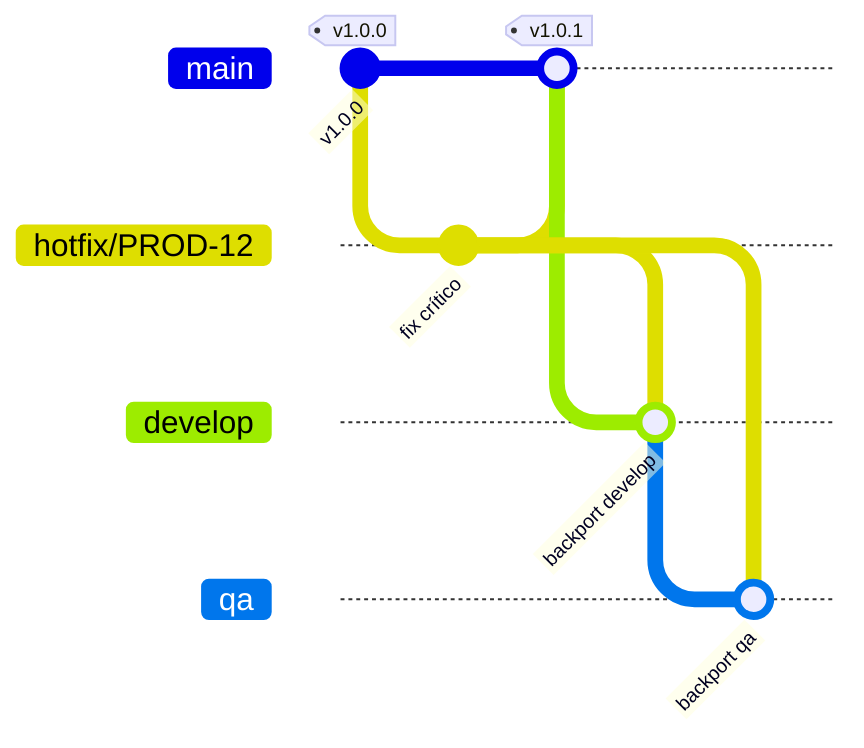

# Protocolo de Hotfixes (Runbook Operativo) — INTELIX / IA-DLC

> **Runbook operativo (M3).** Capa 1 (prevención) + Capa 3 (detección). Cierra la
> brecha B3 (ausencia de protocolo de hotfixes). Complementa el modelo formal de
> `docs/estrategia-control-versiones.md` y la directiva `branching-rules.md`.

**Ramas (nombres en inglés):** `master` (producción), `qa` (calidad),
`develop` (desarrollo).

---

## 1. ¿Cuándo aplica un hotfix?

Un hotfix es un **parche de emergencia sobre producción**. Se usa **solo** para
fallos **críticos** en `master` que no pueden esperar al ciclo normal
`develop → qa → master`.

- ✅ **Sí aplica:** caída de servicio, corrupción de datos, fallo de seguridad
  activo, error que bloquea una operación de negocio crítica en producción.
- ❌ **No aplica:** mejoras, features, refactors, bugs no críticos o que pueden
  esperar al siguiente release. Esos van por `feature/*` o `bugfix/*` → `develop`.

> **Criterio de gravedad:** si el fallo no está en producción **ahora** y no es
> crítico, **no es un hotfix**. Úsalo con disciplina; abusar del hotfix rompe el
> gobierno de ramas.

---

## 2. Los 7 pasos del protocolo

| # | Fase | Comando / Acción | Responsable |
|---|------|------------------|-------------|
| 1 | Creación | `hotfix/<ID>-<desc>` desde `master` (ver 2.1) | Desarrollador asignado |
| 2 | Desarrollo | Implementar el fix. Commits `fix(<ID>): descripción` (ver 2.2) | Desarrollador |
| 3 | Certificación | MR hacia `master`; pruebas aceleradas | Líder de Arquitectura aprueba |
| 4 | Despliegue | Merge a `master` (Merge Commit) + tag `vX.Y.Z` + deploy PROD | DevOps / Release Manager |
| 5 | Backporting | Llevar el fix a `develop` (ver 2.3) | Desarrollador |
| 6 | Backporting | Llevar el fix a `qa` (ver 2.3) | Desarrollador |
| 7 | Limpieza | Eliminar la rama hotfix. Cerrar el incidente | Automático / DevOps |

### 2.1 Paso 1 — Crear la rama desde `master`

Usa la herramienta (verifica la rama origen automáticamente):

```
node scripts/git-flow/bootstrap-ramas.js branch --tipo hotfix --id PROD-12 --desc "fuga de memoria en sync" --apply
```

Equivalente manual (la herramienta hace esto por ti):

```
git checkout master
git pull origin master
git checkout -b hotfix/PROD-12-fuga-de-memoria-en-sync
```

> El `hotfix/*` **SIEMPRE** nace de `master`. Nunca de `develop` ni de `qa`.

### 2.2 Paso 2 — Implementar y commitear

- Aplica el fix mínimo necesario. Nada de mejoras "de paso".
- Cumple la baseline de seguridad aplicable (`seguridad-baseline.md`): un hotfix
  no puede introducir una brecha nueva.
- Arma el mensaje con el selector (ID jerárquico del `SEGUIMIENTO-*.xlsx`):

  ```
  node scripts/entregables/seleccionar-commit.js --id <ID> --tipo fix --desc "<descripcion>" --json
  ```

  Ejemplo de mensaje: `fix(PROD-12): corrige fuga de memoria en la sincronizacion`.

### 2.3 Pasos 5 y 6 — Backporting OBLIGATORIO (dual)

Tras mergear a `master`, el mismo cambio DEBE llegar a `develop` **Y** a `qa`, o
el fix se perderá en el próximo release y el bug **reaparecerá**.

```
# a develop
git checkout develop
git pull origin develop
git merge --no-ff hotfix/PROD-12-fuga-de-memoria-en-sync
git push origin develop        # vía MR si develop está protegida

# a qa
git checkout qa
git pull origin qa
git merge --no-ff hotfix/PROD-12-fuga-de-memoria-en-sync
git push origin qa             # vía MR si qa está protegida
```

> Si `develop`/`qa` están protegidas en GitLab (lo estarán con la Capa 2), el
> backport también pasa por Merge Request. La estrategia del hotfix es **Merge
> Commit** (no squash) para preservar la trazabilidad del parche en las tres ramas.

---

## 3. Diagrama del flujo



> **Fallback en texto:** `hotfix/*` nace de `master`, se mergea de vuelta a
> `master` con tag `vX.Y.Z`, y el mismo commit se backportea a `develop` y a `qa`.
> (En el diagrama `main` representa `master`.)

---

## 4. Reglas inquebrantables

- ❌ **Prohibido** commit directo a `master` sin `hotfix/*` + Merge Request.
- ❌ **Prohibido** usar hotfix para cambios no críticos.
- ✅ El **backporting a `develop` Y `qa` es OBLIGATORIO**, no opcional.
- ✅ Todo hotfix lleva **tag semántico** `vX.Y.Z` (incremento de patch).
- ✅ El hotfix cierra el **incidente** asociado y queda trazado por su ID.

---

## 5. Enforcement por capa

- **Capa 1 (prevención):** el agente IA (Kiro/Copilot/Claude/Amazon Q) conoce y
  lista estos 7 pasos, se niega a commitear directo a `master` y recuerda el
  backport dual. Guiado por `branching-rules.md` y este runbook.
- **Capa 2 (bloqueo):** GitLab rechaza el push directo a `master` y exige MR con
  aprobación (`docs/guia-configuracion-gitlab.md`). **Limitación honesta:** GitLab
  **no** puede forzar el backporting — un hotfix mergeado a `master` que nunca
  llega a `develop`/`qa` no es bloqueable por el servidor.
- **Capa 3 (detección):** el job `backport-check` (`.gitlab-ci.yml.reference`)
  corre semanalmente, revisa los tags recientes de `master` y verifica que los
  commits del hotfix existan también en `develop` y `qa`; si falta el backport,
  alerta en el issue/canal del equipo.

---

## 6. Checklist rápido (para el MR de hotfix)

- [ ] La rama nace de `master` y sigue la nomenclatura `hotfix/<ID>-<desc>`.
- [ ] El fix es mínimo y crítico (no incluye mejoras ni features).
- [ ] Commits semánticos `fix(<ID>): ...` con el ID del `SEGUIMIENTO-*.xlsx`.
- [ ] Controles de seguridad aplicables verificados (`seguridad-baseline.md`).
- [ ] MR a `master` aprobado por el Líder de Arquitectura.
- [ ] Tag `vX.Y.Z` colocado tras el merge.
- [ ] **Backport a `develop` realizado.**
- [ ] **Backport a `qa` realizado.**
- [ ] Rama hotfix eliminada e incidente cerrado.

---

## 7. Documentos relacionados

- `docs/estrategia-control-versiones.md` — modelo formal de branching (M1).
- `.kiro/steering/branching-rules.md` — directiva Capa 1 (sección 6, hotfix).
- `docs/guia-configuracion-gitlab.md` — protección de ramas (Capa 2).
- `.gitlab-ci.yml.reference` — `backport-check` (Capa 3).
- `.kiro/steering/commit-rules.md` — formato del mensaje de commit.
- `.kiro/steering/seguridad-baseline.md` — controles de seguridad por unidad.
