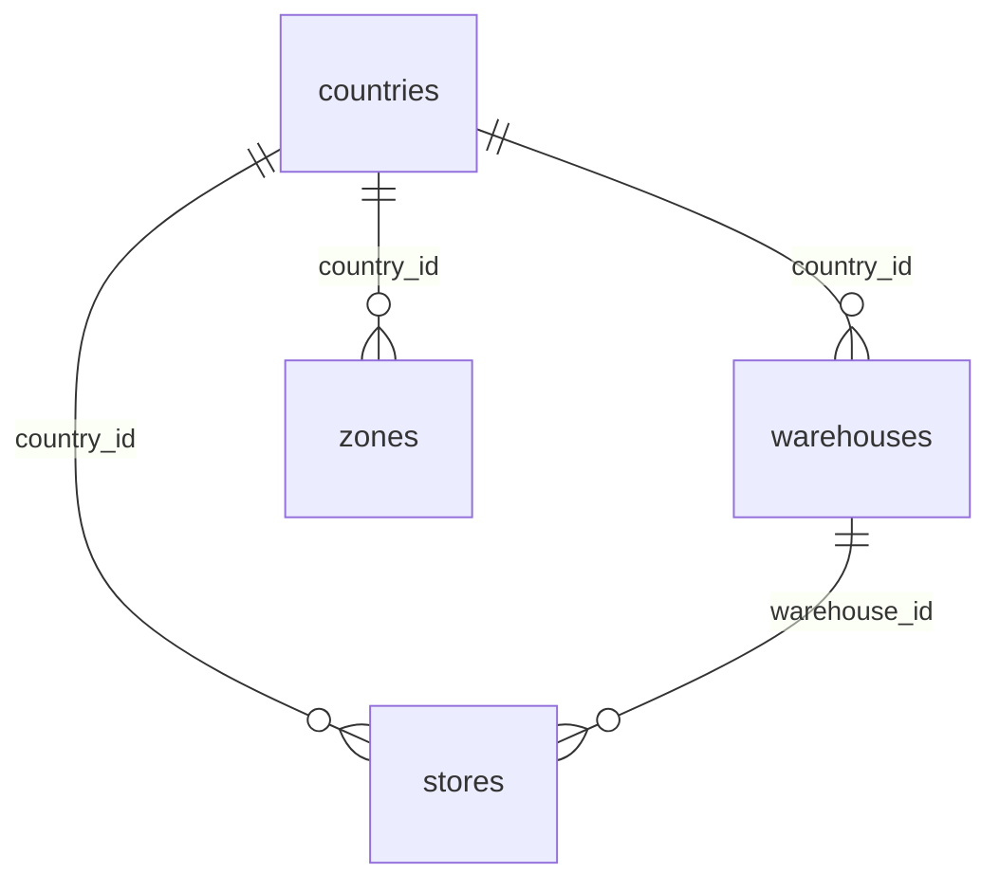
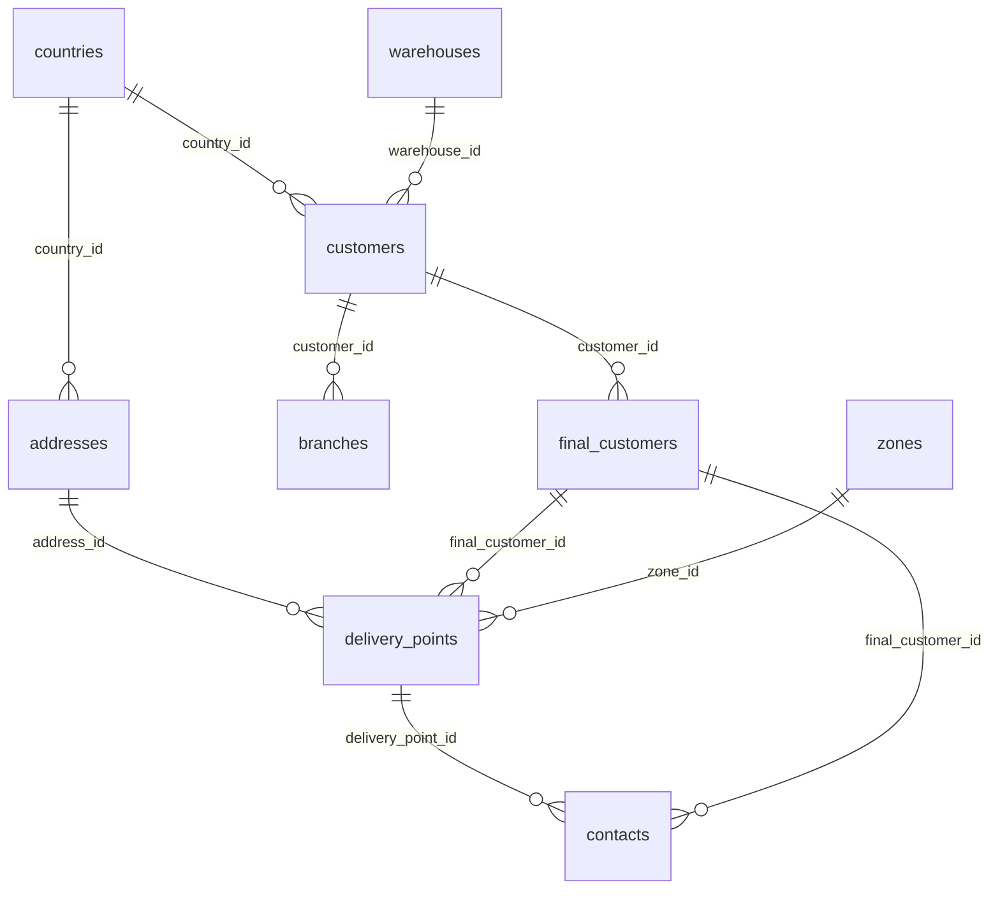
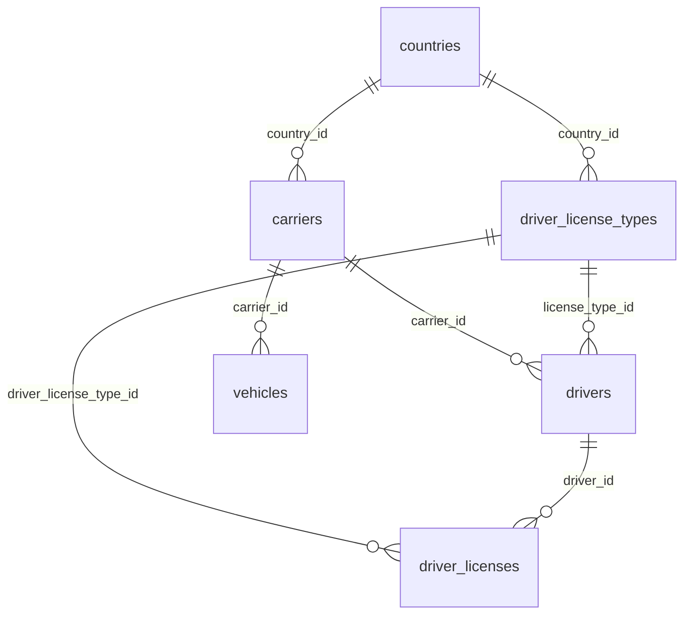
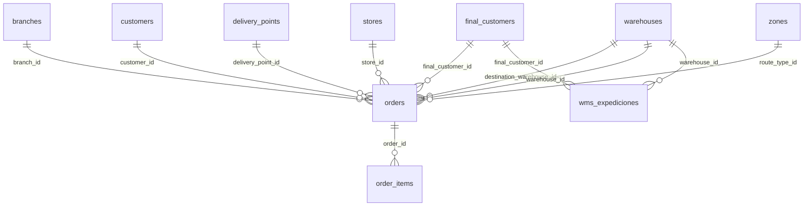
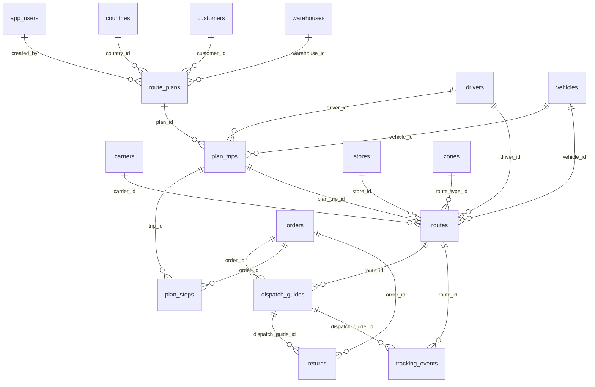
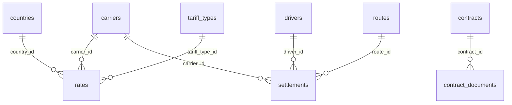
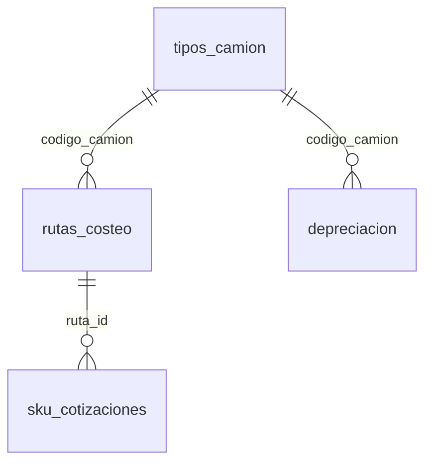
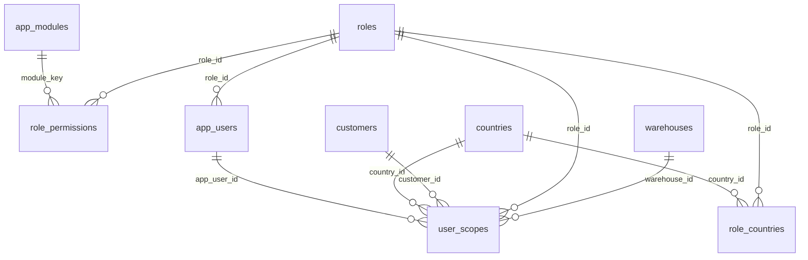

# Diccionario de datos — `tms_olo` (Aurora PostgreSQL)

> **Generado el 2026-10-16** desde la base real con [`scripts/diccionario-datos.py`](../../scripts/diccionario-datos.py). No editar a mano: las estructuras (columnas, tipos, llaves, índices, triggers) salen del catálogo de PostgreSQL; las descripciones de tabla viven en el script. Para regenerar: abrir el túnel (`scripts/tunel-aurora.ps1`) y correr `python scripts/diccionario-datos.py`.

- **Servidor:** PostgreSQL 17.7 on x86_64-pc-linux-gnu — cluster `db-tms-olo` (us-east-2), base `tms_olo`. Conexión y túnel: [`aws-inventario-tms.md`](aws-inventario-tms.md), [`../guides/tunel-ssm-a-rds.md`](../guides/tunel-ssm-a-rds.md).
- **Contenido:** 67 tablas y 8 vistas en los esquemas `public` (negocio) y `audit` (bitácora).
- **Filas:** conteo exacto (`count(*)`) al 2026-10-16. "—" = el rol de la app (`tms_app`) no tiene permiso de lectura.
- Casi todas las tablas llevan `organization_id → organizations`; esa relación se omite en los diagramas para que se lean.

## Índice

**Organización, países y almacenes:** [`organizations`](#publicorganizations), [`countries`](#publiccountries), [`warehouses`](#publicwarehouses), [`stores`](#publicstores), [`zones`](#publiczones)

**Clientes y puntos de entrega:** [`customers`](#publiccustomers), [`branches`](#publicbranches), [`final_customers`](#publicfinal_customers), [`delivery_points`](#publicdelivery_points), [`addresses`](#publicaddresses), [`contacts`](#publiccontacts)

**Transportistas y flota:** [`carriers`](#publiccarriers), [`drivers`](#publicdrivers), [`driver_license_types`](#publicdriver_license_types), [`driver_licenses`](#publicdriver_licenses), [`vehicles`](#publicvehicles), [`vehicle_types`](#publicvehicle_types)

**Pedidos y WMS:** [`orders`](#publicorders), [`order_items`](#publicorder_items), [`wms_expediciones`](#publicwms_expediciones)

**Planificación y ejecución de rutas:** [`route_plans`](#publicroute_plans), [`plan_trips`](#publicplan_trips), [`plan_stops`](#publicplan_stops), [`routes`](#publicroutes), [`dispatch_guides`](#publicdispatch_guides), [`tracking_events`](#publictracking_events), [`returns`](#publicreturns)

**Tarifas, contratos y liquidaciones:** [`rates`](#publicrates), [`tariff_types`](#publictariff_types), [`contracts`](#publiccontracts), [`contract_documents`](#publiccontract_documents), [`settlements`](#publicsettlements)

**Costeo de transporte:** [`tipos_camion`](#publictipos_camion), [`costos_fijos`](#publiccostos_fijos), [`costos_variables`](#publiccostos_variables), [`depreciacion`](#publicdepreciacion), [`parametros_globales`](#publicparametros_globales), [`rutas_costeo`](#publicrutas_costeo), [`sku_cotizaciones`](#publicsku_cotizaciones), [`v_costo_fijo_mensual`](#publicv_costo_fijo_mensual), [`v_costo_variable_por_km`](#publicv_costo_variable_por_km)

**Seguridad y acceso:** [`app_users`](#publicapp_users), [`auth_credentials`](#publicauth_credentials), [`roles`](#publicroles), [`role_permissions`](#publicrole_permissions), [`role_countries`](#publicrole_countries), [`app_modules`](#publicapp_modules), [`user_scopes`](#publicuser_scopes)

**Sistema y auditoría:** [`schema_migrations`](#publicschema_migrations), [`audit.events`](#auditevents), [`audit.tracked_tables`](#audittracked_tables)

**Sin clasificar (nuevas desde la última revisión):** [`geography_columns`](#publicgeography_columns), [`geometry_columns`](#publicgeometry_columns), [`spatial_ref_sys`](#publicspatial_ref_sys), [`tarifas_audit_log`](#publictarifas_audit_log), [`tarifas_cost_structure_rows`](#publictarifas_cost_structure_rows), [`tarifas_cost_structures`](#publictarifas_cost_structures), [`tarifas_country_settings`](#publictarifas_country_settings), [`tarifas_margin_policies`](#publictarifas_margin_policies), [`tarifas_party_variables`](#publictarifas_party_variables), [`tarifas_pricing_rules`](#publictarifas_pricing_rules), [`tarifas_pricing_templates`](#publictarifas_pricing_templates), [`tarifas_rate_table_rows`](#publictarifas_rate_table_rows), [`tarifas_rate_tables`](#publictarifas_rate_tables), [`tarifas_settlement_parties`](#publictarifas_settlement_parties), [`tarifas_settlements`](#publictarifas_settlements), [`tarifas_trip_order_marks`](#publictarifas_trip_order_marks), [`tarifas_v_devoluciones`](#publictarifas_v_devoluciones), [`tarifas_v_viaje_cargas`](#publictarifas_v_viaje_cargas), [`tarifas_v_viaje_pedidos`](#publictarifas_v_viaje_pedidos), [`tarifas_v_viajes`](#publictarifas_v_viajes), [`tarifas_zone_groups`](#publictarifas_zone_groups), [`tracking_evidences`](#publictracking_evidences), [`tracking_last_positions`](#publictracking_last_positions), [`tracking_positions`](#publictracking_positions)

## Observaciones (revisión 2026-09-30)

- **Scripts que no están en la base:** las tablas de `sql/01_fase1_zonas_reglas.sql` (`zone_groups`, `zone_lane_rates`,
  `pricing_rules`, `fx_rates`) y de `sql/03_fase3_plantillas.sql` (`pricing_templates`) **no existen** en `tms_olo`.
  O no se aplicaron, o se borraron después.
- **`route_type_id` apunta a `zones`:** `orders.route_type_id` y `routes.route_type_id` son FK a `zones`, porque
  `route_types` se renombró a `zones` en `sql/09` y la columna conservó el nombre viejo.
- **Comentario desactualizado:** `drivers.license_type_id` dice "FK a license_types", pero la tabla ahora es
  `driver_license_types` (renombrada en `sql/06`). La FK real apunta bien.
- **Tablas vacías (0 filas):** `contacts`, `contracts`, `contract_documents`, `driver_licenses`, `rates`, `returns`,
  `role_countries`, `rutas_costeo`, `settlements`, `sku_cotizaciones`, `tracking_events`.
- **El OMS no tiene esquema propio** (decidido el 2026-10-16; reemplaza los esquemas `OMS`/`TMS` del 2026-09-15):
  todo vive en `public`. El OMS lee y escribe sus pedidos en `public.orders`; sus tablas propias (simulaciones,
  etc.) todavía no existen y se crearán también en `public`.
- **Casi sin `COMMENT ON`:** solo 3 tablas y 6 columnas tienen comentario en la base; las descripciones de este
  documento se escribieron a partir de los nombres, las columnas y los scripts `sql/`.
- **Permisos de `tms_app`:** no puede leer `public.schema_migrations` ni `audit.tracked_tables`, por eso no se cuentan
  sus filas. Es coherente con `sql/18` (la app no necesita esas tablas).

---

## Organización, países y almacenes



<a id="publicorganizations"></a>

### `public.organizations`

*tabla · 1 filas* — Organización dueña de los datos (hoy una sola: OLO). Casi todas las tablas cuelgan de ella.

| Columna | Tipo | Nulo | Default | Notas |
|---|---|---|---|---|
| `id` | `uuid` | no | `gen_random_uuid()` | **PK** |
| `name` | `character varying(255)` | no |  |  |
| `slug` | `character varying(100)` | no |  | único |
| `logo_url` | `text` | sí |  |  |
| `status` | `character varying(50)` | sí | `'active'::character varying` |  |
| `created_at` | `timestamp with time zone` | sí | `now()` |  |
| `updated_at` | `timestamp with time zone` | sí | `now()` |  |

- Índice: `btree (slug)` — `idx_organizations_slug`
- Índice: `btree (status)` — `idx_organizations_status`
- Trigger: auditada — cada INSERT/UPDATE/DELETE queda en `audit.events`.

<a id="publiccountries"></a>

### `public.countries`

*tabla · 2 filas* — Países donde opera la organización (CR, VE) con moneda, zona horaria, idioma y formatos.

| Columna | Tipo | Nulo | Default | Notas |
|---|---|---|---|---|
| `id` | `uuid` | no | `gen_random_uuid()` | **PK** |
| `organization_id` | `uuid` | no |  | FK → [`organizations`](#publicorganizations) |
| `name` | `character varying(100)` | no |  |  |
| `code` | `character varying(3)` | no |  |  |
| `currency` | `character varying(3)` | no |  |  |
| `timezone` | `character varying(50)` | no |  |  |
| `status` | `character varying(50)` | sí | `'active'::character varying` |  |
| `created_at` | `timestamp with time zone` | sí | `now()` |  |
| `updated_at` | `timestamp with time zone` | sí | `now()` |  |
| `iso_code` | `character varying(3)` | sí |  |  |
| `phone_code` | `character varying(10)` | sí |  |  |
| `flag_emoji` | `character varying(10)` | sí |  |  |
| `capital` | `character varying(100)` | sí |  |  |
| `language` | `character varying(100)` | sí |  |  |
| `notes` | `text` | sí |  |  |
| `locale` | `text` | sí |  |  |
| `unit_system` | `text` | sí |  |  |
| `date_format` | `text` | sí |  |  |

- Único: `UNIQUE (organization_id, code)`
- Índice: `btree (code)` — `idx_countries_code`
- Índice: `btree (organization_id)` — `idx_countries_org`
- Trigger: auditada — cada INSERT/UPDATE/DELETE queda en `audit.events`.

<a id="publicwarehouses"></a>

### `public.warehouses`

*tabla · 4 filas* — Almacenes/CEDIS por país. Nivel de la jerarquía entre país y cliente.

| Columna | Tipo | Nulo | Default | Notas |
|---|---|---|---|---|
| `id` | `uuid` | no | `gen_random_uuid()` | **PK** |
| `organization_id` | `uuid` | no |  | FK → [`organizations`](#publicorganizations) |
| `country_id` | `uuid` | no |  | FK → [`countries`](#publiccountries) |
| `code` | `text` | no |  |  |
| `name` | `text` | no |  |  |
| `timezone` | `text` | no |  |  |
| `currency_id` | `text` | sí |  |  |
| `address` | `text` | sí |  |  |
| `latitude` | `numeric` | sí |  |  |
| `longitude` | `numeric` | sí |  |  |
| `active` | `boolean` | no | `true` |  |
| `created_at` | `timestamp with time zone` | no | `now()` |  |
| `updated_at` | `timestamp with time zone` | no | `now()` |  |
| `source_system` | `text` | sí |  | Instancia de EFLOW de donde viene el almacén: EFLOW_OLO (CR), EFLOW_FEBECA, EFLOW_BEVAL (VE). |
| `external_code` | `character varying(4)` | sí |  | EFLOW ALMACENES.IDALMACEN. Único por source_system. |

- Único: `UNIQUE (country_id, code)`
- Índice: `btree (source_system, external_code) WHERE (external_code IS NOT NULL)` (único) — `uidx_warehouse_source_external_code`
- Trigger: auditada — cada INSERT/UPDATE/DELETE queda en `audit.events`.

<a id="publicstores"></a>

### `public.stores`

*tabla · 7 filas* — Tiendas y puntos de origen. `is_origin = true` marca los orígenes de despacho; las tiendas EPA pasaron a `delivery_points` (`sql/13`).

| Columna | Tipo | Nulo | Default | Notas |
|---|---|---|---|---|
| `id` | `uuid` | no | `gen_random_uuid()` | **PK** |
| `organization_id` | `uuid` | no |  | FK → [`organizations`](#publicorganizations) |
| `country_id` | `uuid` | no |  | FK → [`countries`](#publiccountries) |
| `name` | `character varying(255)` | no |  |  |
| `code` | `character varying(50)` | no |  |  |
| `address` | `text` | no |  |  |
| `city` | `character varying(100)` | no |  |  |
| `state` | `character varying(100)` | sí |  |  |
| `postal_code` | `character varying(20)` | sí |  |  |
| `latitude` | `numeric(10,8)` | sí |  |  |
| `longitude` | `numeric(11,8)` | sí |  |  |
| `phone` | `character varying(50)` | sí |  |  |
| `email` | `character varying(255)` | sí |  |  |
| `status` | `character varying(50)` | sí | `'active'::character varying` |  |
| `created_at` | `timestamp with time zone` | sí | `now()` |  |
| `updated_at` | `timestamp with time zone` | sí | `now()` |  |
| `store_type` | `character varying(50)` | sí |  |  |
| `manager_name` | `character varying(255)` | sí |  |  |
| `opening_hours` | `character varying(100)` | sí |  |  |
| `capacity` | `integer` | sí |  |  |
| `area_m2` | `numeric(10,2)` | sí |  |  |
| `notes` | `text` | sí |  |  |
| `contact_name` | `character varying(100)` | sí |  |  |
| `contact_phone` | `character varying(50)` | sí |  |  |
| `contact_email` | `character varying(100)` | sí |  |  |
| `delivery_zone` | `character varying(100)` | sí |  |  |
| `is_origin` | `boolean` | sí | `false` |  |
| `warehouse_id` | `uuid` | sí |  | FK → [`warehouses`](#publicwarehouses) |

- Único: `UNIQUE (organization_id, code)`
- Índice: `btree (country_id)` — `idx_stores_country`
- Índice: `btree (organization_id)` — `idx_stores_org`
- Índice: `btree (status)` — `idx_stores_status`
- Trigger: auditada — cada INSERT/UPDATE/DELETE queda en `audit.events`.

<a id="publiczones"></a>

### `public.zones`

*tabla · 17 filas* — Zonas / tipos de ruta por país. Antes se llamaba `route_types` (renombrada en `sql/09`).

| Columna | Tipo | Nulo | Default | Notas |
|---|---|---|---|---|
| `id` | `uuid` | no | `gen_random_uuid()` | **PK** |
| `name` | `text` | no |  |  |
| `status` | `text` | no | `'active'::text` |  |
| `organization_id` | `uuid` | no |  | FK → [`organizations`](#publicorganizations) |
| `created_at` | `timestamp with time zone` | sí | `now()` |  |
| `updated_at` | `timestamp with time zone` | sí | `now()` |  |
| `country_id` | `uuid` | no |  | FK → [`countries`](#publiccountries) |
| `code` | `text` | sí |  |  |
| `geofence` | `jsonb` | sí |  |  |
| `color` | `text` | sí |  |  |

- Check `zones_geofence_geojson_check`: `CHECK (((geofence IS NULL) OR ((geofence ->> 'type'::text) = ANY (ARRAY['Polygon'::text, 'MultiPolygon'::text]))))`
- Check `zones_status_check`: `CHECK ((status = ANY (ARRAY['active'::text, 'inactive'::text])))`
- Índice: `btree (organization_id)` — `idx_route_types_organization`
- Índice: `btree (status)` — `idx_route_types_status`
- Índice: `btree (country_id, code) WHERE (code IS NOT NULL)` (único) — `zones_country_code_key`
- Índice: `btree (country_id)` — `zones_country_id_idx`
- Trigger: auditada — cada INSERT/UPDATE/DELETE queda en `audit.events`.
- Trigger `zones_reassign_points_trg`: `CREATE TRIGGER zones_reassign_points_trg AFTER INSERT OR DELETE OR UPDATE OF geofence, status, country_id ON public.zones FOR EACH ROW EXECUTE FUNCTION zones_reassign_points()`

---

## Clientes y puntos de entrega



<a id="publiccustomers"></a>

### `public.customers`

*tabla · 5 filas* — Compañías clientes de OLO (Cofersa, EPA…) = EFLOW COMPANIA; código EFLOW en `external_code` (`sql/40`).

> Comentario en la base: Incluye Cofersa/EPA como clientes reales desde 2026-09-16 (antes solo existían como fuentes de datos/reglas del OMS, no como filas de este catálogo).

| Columna | Tipo | Nulo | Default | Notas |
|---|---|---|---|---|
| `id` | `uuid` | no | `gen_random_uuid()` | **PK** |
| `organization_id` | `uuid` | no |  | FK → [`organizations`](#publicorganizations) |
| `country_id` | `uuid` | no |  | FK → [`countries`](#publiccountries) |
| `code` | `character varying(50)` | no |  |  |
| `name` | `character varying(255)` | no |  |  |
| `tax_id` | `character varying(50)` | sí |  |  |
| `email` | `character varying(255)` | sí |  |  |
| `phone` | `character varying(50)` | sí |  |  |
| `address` | `text` | sí |  |  |
| `city` | `character varying(100)` | sí |  |  |
| `state` | `character varying(100)` | sí |  |  |
| `postal_code` | `character varying(20)` | sí |  |  |
| `latitude` | `numeric(10,8)` | sí |  |  |
| `longitude` | `numeric(11,8)` | sí |  |  |
| `delivery_zone` | `character varying(100)` | sí |  |  |
| `status` | `character varying(50)` | sí | `'active'::character varying` |  |
| `created_at` | `timestamp with time zone` | sí | `now()` |  |
| `updated_at` | `timestamp with time zone` | sí | `now()` |  |
| `warehouse_id` | `uuid` | sí |  | FK → [`warehouses`](#publicwarehouses) |
| `source_system` | `text` | sí |  | Instancia de EFLOW de donde viene la compañía: EFLOW_OLO (CR), EFLOW_FEBECA, EFLOW_BEVAL (VE). |
| `external_code` | `character varying(4)` | sí |  | EFLOW COMPANIA.IDCOMPANIA (ej. 0029 = EPA, 0109 = Cofersa). Único por source_system. |

- Único: `UNIQUE (organization_id, code)`
- Índice: `gin (name gin_trgm_ops)` — `customers_name_trgm`
- Índice: `btree (country_id)` — `idx_customer_country`
- Índice: `btree (delivery_zone)` — `idx_customer_delivery_zone`
- Índice: `btree (organization_id)` — `idx_customer_organization`
- Índice: `btree (source_system, external_code) WHERE (external_code IS NOT NULL)` (único) — `uidx_customer_source_external_code`
- Índice: `btree (warehouse_id, code)` (único) — `uidx_customer_warehouse_code`
- Trigger: auditada — cada INSERT/UPDATE/DELETE queda en `audit.events`.

<a id="publicbranches"></a>

### `public.branches`

*tabla · 8 filas* — Sucursales de cada compañía = EFLOW SUCURSAL (sobrante, garantías, crossdock…) (`sql/40`).

> Comentario en la base: Sucursales de cada compañía (EFLOW SUCURSAL, PK IDCOMPANIA+IDSUCURSAL). Cambian reglas de despacho/prioridad (sobrante, garantía, crossdock).

| Columna | Tipo | Nulo | Default | Notas |
|---|---|---|---|---|
| `id` | `uuid` | no | `gen_random_uuid()` | **PK** |
| `customer_id` | `uuid` | no |  | FK → [`customers`](#publiccustomers) |
| `external_code` | `character varying(4)` | no |  | EFLOW SUCURSAL.IDSUCURSAL. Único por compañía. |
| `name` | `text` | no |  | EFLOW NOMBRELARGOSUCURSAL. |
| `short_name` | `text` | sí |  | EFLOW NOMBRECORTOSUCURSAL. |
| `branch_type` | `text` | sí |  | EFLOW TIPOSUCURSAL. |
| `tax_id` | `text` | sí |  | EFLOW NUMEROIDENTIFICACION. |
| `erp_reference` | `text` | sí |  | EFLOW IDREFERENCIAERP (cruce con Softland). |
| `country` | `text` | sí |  |  |
| `province` | `text` | sí |  |  |
| `city` | `text` | sí |  |  |
| `address` | `text` | sí |  |  |
| `email` | `text` | sí |  |  |
| `phone` | `text` | sí |  |  |
| `status` | `text` | no | `'active'::text` | Derivado de EFLOW SITUACION. |
| `created_at` | `timestamp with time zone` | no | `now()` |  |
| `updated_at` | `timestamp with time zone` | no | `now()` |  |

- Check `ck_branch_status`: `CHECK ((status = ANY (ARRAY['active'::text, 'inactive'::text])))`
- Único: `UNIQUE (customer_id, external_code)`
- Índice: `btree (customer_id)` — `idx_branch_customer`
- Trigger: auditada — cada INSERT/UPDATE/DELETE queda en `audit.events`.

<a id="publicfinal_customers"></a>

### `public.final_customers`

*tabla · 32.871 filas* — Clientes destino = EFLOW CLIENTES: tiendas EPA (`TIENDA`) y clientes de mayoreo (`MAYOREO`) (`sql/41`–`42`).

| Columna | Tipo | Nulo | Default | Notas |
|---|---|---|---|---|
| `id` | `uuid` | no | `gen_random_uuid()` | **PK** |
| `customer_id` | `uuid` | no |  | FK → [`customers`](#publiccustomers) |
| `external_code` | `text` | no |  | EFLOW CLIENTES.IDCLIENTE (texto, ceros a la izquierda). Único por compañía (customer_id). |
| `name` | `text` | no |  | EFLOW NOMBRELARGO. |
| `region` | `text` | sí |  |  |
| `status` | `text` | no | `'active'::text` | active / inactive. Derivado de EFLOW TPCLSI (DISP -> active, BLOQ -> inactive). |
| `created_at` | `timestamp with time zone` | no | `now()` |  |
| `updated_at` | `timestamp with time zone` | no | `now()` |  |
| `customer_type` | `text` | no |  | TIENDA (tiendas de EPA) o MAYOREO (resto de clientes). |
| `short_name` | `text` | sí |  | EFLOW NOMBRECORTO. |
| `contact` | `text` | sí |  | EFLOW CONTACTO. |
| `phone` | `text` | sí |  | EFLOW TELEFONO. |
| `mobile` | `text` | sí |  | EFLOW CELULAR. |
| `email` | `text` | sí |  | EFLOW EMAIL. |
| `erp_reference` | `text` | sí |  | EFLOW REFERENCIA_ERP. |
| `wms_client_type` | `text` | sí |  | EFLOW TPCLIE (ej. NACION, INTERN). |
| `wms_client_class` | `text` | sí |  | EFLOW TPCLSE (ej. A, B, C, Z). |

- Check `ck_final_customer_customer_type`: `CHECK ((customer_type = ANY (ARRAY['TIENDA'::text, 'MAYOREO'::text])))`
- Check `ck_final_customer_status`: `CHECK ((status = ANY (ARRAY['active'::text, 'inactive'::text])))`
- Único: `UNIQUE (customer_id, external_code)`
- Índice: `btree (customer_id, customer_type)` — `idx_final_customer_customer_type`
- Trigger: auditada — cada INSERT/UPDATE/DELETE queda en `audit.events`.

<a id="publicdelivery_points"></a>

### `public.delivery_points`

*tabla · 32.871 filas* — Puntos de entrega de un cliente final, con dirección, ventana horaria, zona y códigos de ruta/zona WMS.

| Columna | Tipo | Nulo | Default | Notas |
|---|---|---|---|---|
| `id` | `uuid` | no | `gen_random_uuid()` | **PK** |
| `final_customer_id` | `uuid` | no |  | FK → [`final_customers`](#publicfinal_customers) |
| `address_id` | `uuid` | sí |  | FK → [`addresses`](#publicaddresses) |
| `external_code` | `text` | sí |  |  |
| `name` | `text` | no |  |  |
| `delivery_instructions` | `text` | sí |  |  |
| `delivery_window_start` | `time without time zone` | sí |  |  |
| `delivery_window_end` | `time without time zone` | sí |  |  |
| `is_default` | `boolean` | no | `false` |  |
| `active` | `boolean` | no | `true` |  |
| `created_at` | `timestamp with time zone` | no | `now()` |  |
| `updated_at` | `timestamp with time zone` | no | `now()` |  |
| `zone_id` | `uuid` | sí |  | FK → [`zones`](#publiczones) |
| `route_code` | `text` | sí |  |  |
| `wms_zone_code` | `text` | sí |  |  |
| `zone_source` | `text` | no | `'map'::text` |  |
| `contact_phone` | `text` | sí |  |  |

- Check `delivery_points_zone_source_check`: `CHECK ((zone_source = ANY (ARRAY['map'::text, 'manual'::text, 'wms'::text])))`
- Índice: `btree (final_customer_id, external_code) WHERE (external_code IS NOT NULL)` (único) — `delivery_points_final_customer_external_code_key`
- Índice: `btree (final_customer_id)` — `delivery_points_final_customer_id_idx`
- Índice: `btree (final_customer_id) WHERE is_default` (único) — `delivery_points_one_default_per_final_customer`
- Índice: `btree (zone_id)` — `delivery_points_zone_id_idx`
- Trigger: auditada — cada INSERT/UPDATE/DELETE queda en `audit.events`.
- Trigger `delivery_points_zone_source_trg`: `CREATE TRIGGER delivery_points_zone_source_trg BEFORE INSERT OR UPDATE OF zone_id, zone_source, address_id ON public.delivery_points FOR EACH ROW EXECUTE FUNCTION delivery_points_zone_source()`

<a id="publicaddresses"></a>

### `public.addresses`

*tabla · 32.871 filas* — Direcciones geocodificables, referenciadas por los puntos de entrega.

| Columna | Tipo | Nulo | Default | Notas |
|---|---|---|---|---|
| `id` | `uuid` | no | `gen_random_uuid()` | **PK** |
| `country_id` | `uuid` | no |  | FK → [`countries`](#publiccountries) |
| `line1` | `text` | sí |  |  |
| `line2` | `text` | sí |  |  |
| `city` | `text` | sí |  |  |
| `state` | `text` | sí |  |  |
| `postal_code` | `text` | sí |  |  |
| `latitude` | `numeric` | sí |  |  |
| `longitude` | `numeric` | sí |  |  |
| `geocoding_status` | `text` | no | `'PENDING'::text` |  |
| `geocoding_provider` | `text` | sí |  |  |
| `geocoded_at` | `timestamp with time zone` | sí |  |  |
| `created_at` | `timestamp with time zone` | no | `now()` |  |
| `updated_at` | `timestamp with time zone` | no | `now()` |  |

- Trigger: auditada — cada INSERT/UPDATE/DELETE queda en `audit.events`.
- Trigger `addresses_reassign_point_trg`: `CREATE TRIGGER addresses_reassign_point_trg AFTER UPDATE OF latitude, longitude, country_id ON public.addresses FOR EACH ROW WHEN (((old.latitude IS DISTINCT FROM new.latitude) OR (old.longitude IS DISTINCT FROM new.longitude) OR (old.country_id IS DISTINCT FROM new.country_id))) EXECUTE FUNCTION addresses_reassign_point()`

<a id="publiccontacts"></a>

### `public.contacts`

*tabla · 0 filas* — Contactos de un cliente final o de un punto de entrega.

| Columna | Tipo | Nulo | Default | Notas |
|---|---|---|---|---|
| `id` | `uuid` | no | `gen_random_uuid()` | **PK** |
| `final_customer_id` | `uuid` | sí |  | FK → [`final_customers`](#publicfinal_customers) |
| `delivery_point_id` | `uuid` | sí |  | FK → [`delivery_points`](#publicdelivery_points) |
| `name` | `text` | sí |  |  |
| `phone` | `text` | sí |  |  |
| `email` | `text` | sí |  |  |
| `role` | `text` | sí |  |  |
| `created_at` | `timestamp with time zone` | no | `now()` |  |

- Check `contacts_exactly_one_parent`: `CHECK (((((final_customer_id IS NOT NULL))::integer + ((delivery_point_id IS NOT NULL))::integer) = 1))`
- Trigger: auditada — cada INSERT/UPDATE/DELETE queda en `audit.events`.

---

## Transportistas y flota



<a id="publiccarriers"></a>

### `public.carriers`

*tabla · 9 filas* — Transportistas (terceros y flota propia) por país.

| Columna | Tipo | Nulo | Default | Notas |
|---|---|---|---|---|
| `id` | `uuid` | no | `gen_random_uuid()` | **PK** |
| `organization_id` | `uuid` | no |  | FK → [`organizations`](#publicorganizations) |
| `name` | `character varying(255)` | no |  |  |
| `code` | `character varying(50)` | no |  |  |
| `tax_id` | `character varying(50)` | sí |  |  |
| `email` | `character varying(255)` | sí |  |  |
| `phone` | `character varying(50)` | sí |  |  |
| `address` | `text` | sí |  |  |
| `status` | `character varying(50)` | sí | `'active'::character varying` |  |
| `created_at` | `timestamp with time zone` | sí | `now()` |  |
| `updated_at` | `timestamp with time zone` | sí | `now()` |  |
| `contact_name` | `character varying(255)` | sí |  |  |
| `country_id` | `uuid` | sí |  | FK → [`countries`](#publiccountries) |
| `payment_account` | `text` | sí |  | Cuenta bancaria/contable para pagar al transportista (borrador, 2026-09-16) |
| `softland_code` | `text` | sí |  | Código del transportista en Softland (ERP externo) — integración aún no confirmada (borrador, 2026-09-16) |
| `is_flota_propia` | `boolean` | no | `false` | true = flota propia de la empresa (prioridad en el reparto automático de Planificación); false = transportista tercero. |
| `contract_expiry` | `date` | sí |  |  |
| `contract_file_key` | `text` | sí |  |  |
| `rate_type` | `text` | sí |  |  |
| `flat_rate_amount` | `numeric` | sí |  |  |

- Check `carriers_flat_rate_amount_check`: `CHECK (((flat_rate_amount IS NULL) OR (flat_rate_amount >= (0)::numeric)))`
- Único: `UNIQUE (organization_id, code)`
- Check `carriers_rate_type_check`: `CHECK (((rate_type IS NULL) OR (rate_type = ANY (ARRAY['PER_KM'::text, 'PER_UNIT'::text, 'FIXED'::text, 'VOLUME'::text, 'TENDERING'::text]))))`
- Índice: `btree (organization_id)` — `idx_carriers_org`
- Índice: `btree (status)` — `idx_carriers_status`
- Trigger: auditada — cada INSERT/UPDATE/DELETE queda en `audit.events`.

<a id="publicdrivers"></a>

### `public.drivers`

*tabla · 18 filas* — Conductores de cada transportista.

| Columna | Tipo | Nulo | Default | Notas |
|---|---|---|---|---|
| `id` | `uuid` | no | `gen_random_uuid()` | **PK** |
| `organization_id` | `uuid` | no |  | FK → [`organizations`](#publicorganizations) |
| `carrier_id` | `uuid` | sí |  | FK → [`carriers`](#publiccarriers) |
| `code` | `character varying(50)` | no |  |  |
| `full_name` | `character varying(255)` | no |  |  |
| `license_number` | `character varying(50)` | no |  |  |
| `license_expiry` | `date` | sí |  |  |
| `phone` | `character varying(50)` | no |  |  |
| `email` | `character varying(255)` | sí |  |  |
| `photo_url` | `text` | sí |  |  |
| `status` | `character varying(50)` | sí | `'active'::character varying` |  |
| `created_at` | `timestamp with time zone` | sí | `now()` |  |
| `updated_at` | `timestamp with time zone` | sí | `now()` |  |
| `document` | `character varying(50)` | sí |  |  |
| `license_type` | `character varying(20)` | sí |  |  |
| `notes` | `text` | sí |  |  |
| `license_type_id` | `uuid` | sí |  | FK → [`driver_license_types`](#publicdriver_license_types) · FK a license_types (borrador, 2026-09-16). drivers.license_type (texto libre) se conserva por compatibilidad hacia atrás. |

- Único: `UNIQUE (organization_id, code)`
- Índice: `btree (carrier_id)` — `idx_drivers_carrier`
- Índice: `btree (organization_id)` — `idx_drivers_org`
- Índice: `btree (status)` — `idx_drivers_status`
- Trigger: auditada — cada INSERT/UPDATE/DELETE queda en `audit.events`.

<a id="publicdriver_license_types"></a>

### `public.driver_license_types`

*tabla · 9 filas* — Catálogo de tipos de licencia de conducir por país.

> Comentario en la base: Catálogo de tipos/categorías de licencia de conducir (borrador, 2026-09-16). Sembrado solo con los códigos que ya usan los conductores reales (B, A2, A4) — la lista completa CR/VE queda pendiente de validar.

| Columna | Tipo | Nulo | Default | Notas |
|---|---|---|---|---|
| `id` | `uuid` | no | `gen_random_uuid()` | **PK** |
| `code` | `text` | no |  |  |
| `name` | `text` | no |  |  |
| `description` | `text` | sí |  |  |
| `orden` | `smallint` | no | `0` |  |
| `activo` | `boolean` | no | `true` |  |
| `created_at` | `timestamp with time zone` | no | `now()` |  |
| `updated_at` | `timestamp with time zone` | no | `now()` |  |
| `country_id` | `uuid` | no |  | FK → [`countries`](#publiccountries) |
| `vehicle_restrictions` | `jsonb` | sí |  |  |
| `validity_rules` | `jsonb` | sí |  |  |

- Índice: `btree (country_id, code)` (único) — `driver_license_types_country_code_key`
- Trigger: auditada — cada INSERT/UPDATE/DELETE queda en `audit.events`.

<a id="publicdriver_licenses"></a>

### `public.driver_licenses`

*tabla · 0 filas* — Licencias de un conductor (N:M). Tabla creada pero aún no es la fuente de verdad: lo sigue siendo `drivers.license_type_id`.

| Columna | Tipo | Nulo | Default | Notas |
|---|---|---|---|---|
| `id` | `uuid` | no | `gen_random_uuid()` | **PK** |
| `driver_id` | `uuid` | no |  | FK → [`drivers`](#publicdrivers) |
| `driver_license_type_id` | `uuid` | no |  | FK → [`driver_license_types`](#publicdriver_license_types) |
| `license_number` | `text` | sí |  |  |
| `expiry_date` | `date` | sí |  |  |
| `created_at` | `timestamp with time zone` | no | `now()` |  |

- Único: `UNIQUE (driver_id, driver_license_type_id)`
- Trigger: auditada — cada INSERT/UPDATE/DELETE queda en `audit.events`.

<a id="publicvehicles"></a>

### `public.vehicles`

*tabla · 12 filas* — Vehículos de cada transportista, con capacidad en peso, volumen y tarimas.

| Columna | Tipo | Nulo | Default | Notas |
|---|---|---|---|---|
| `id` | `uuid` | no | `gen_random_uuid()` | **PK** |
| `organization_id` | `uuid` | no |  | FK → [`organizations`](#publicorganizations) |
| `carrier_id` | `uuid` | sí |  | FK → [`carriers`](#publiccarriers) |
| `plate` | `character varying(50)` | no |  |  |
| `brand` | `character varying(100)` | sí |  |  |
| `model` | `character varying(100)` | sí |  |  |
| `year` | `integer` | sí |  |  |
| `vehicle_type` | `character varying(50)` | no |  |  |
| `capacity_weight` | `numeric(10,2)` | sí |  |  |
| `capacity_volume` | `numeric(10,2)` | sí |  |  |
| `fuel_type` | `character varying(50)` | sí |  |  |
| `status` | `character varying(50)` | sí | `'active'::character varying` |  |
| `created_at` | `timestamp with time zone` | sí | `now()` |  |
| `updated_at` | `timestamp with time zone` | sí | `now()` |  |
| `pallets` | `integer` | sí |  |  |
| `image_url` | `text` | sí |  |  |
| `notes` | `text` | sí |  |  |
| `container_width` | `numeric` | sí |  |  |
| `container_height` | `numeric` | sí |  |  |
| `container_length` | `numeric` | sí |  |  |
| `container_unit` | `text` | no | `'cm'::text` |  |

- Check `vehicles_container_dimensions_check`: `CHECK (((COALESCE(container_width, (1)::numeric) > (0)::numeric) AND (COALESCE(container_height, (1)::numeric) > (0)::numeric) AND (COALESCE(container_length, (1)::numeric) > (0)::numeric)))`
- Check `vehicles_container_unit_check`: `CHECK ((container_unit = ANY (ARRAY['cm'::text, 'in'::text, 'ft'::text])))`
- Único: `UNIQUE (organization_id, plate)`
- Índice: `btree (carrier_id)` — `idx_vehicles_carrier`
- Índice: `btree (organization_id)` — `idx_vehicles_org`
- Índice: `btree (status)` — `idx_vehicles_status`
- Trigger: auditada — cada INSERT/UPDATE/DELETE queda en `audit.events`.

<a id="publicvehicle_types"></a>

### `public.vehicle_types`

*tabla · 2 filas* — Catálogo de tipos de vehículo.

| Columna | Tipo | Nulo | Default | Notas |
|---|---|---|---|---|
| `id` | `uuid` | no | `gen_random_uuid()` | **PK** |
| `organization_id` | `uuid` | no |  | FK → [`organizations`](#publicorganizations) |
| `name` | `character varying(100)` | no |  |  |
| `description` | `text` | sí |  |  |
| `icon` | `character varying(50)` | sí | `'ri-truck-line'::character varying` |  |
| `status` | `character varying(20)` | sí | `'activo'::character varying` |  |
| `created_at` | `timestamp with time zone` | sí | `now()` |  |
| `updated_at` | `timestamp with time zone` | sí | `now()` |  |

- Check `vehicle_types_status_check`: `CHECK (((status)::text = ANY (ARRAY[('activo'::character varying)::text, ('inactivo'::character varying)::text])))`
- Trigger: auditada — cada INSERT/UPDATE/DELETE queda en `audit.events`.

---

## Pedidos y WMS



<a id="publicorders"></a>

### `public.orders`

*tabla · 1.234 filas* — Pedidos = EFLOW EXPEDICIONESCABECERA (`sql/43`): almacén, sucursal, cliente destino, llave EFLOW, datos del WMS y resultado del OMS.

> Comentario en la base: Pedidos. Equivale a EFLOW EXPEDICIONESCABECERA (PK IDALMACEN+IDCOMPANIA+IDSUCURSAL+IDEXPEDICION). El OMS escribe aquí prioridad, score y situación; Planificación lee de aquí.

| Columna | Tipo | Nulo | Default | Notas |
|---|---|---|---|---|
| `id` | `uuid` | no | `gen_random_uuid()` | **PK** |
| `organization_id` | `uuid` | no |  | FK → [`organizations`](#publicorganizations) |
| `store_id` | `uuid` | sí |  | FK → [`stores`](#publicstores) |
| `customer_id` | `uuid` | no |  | FK → [`customers`](#publiccustomers) |
| `order_number` | `character varying(100)` | no |  |  |
| `invoice_number` | `character varying(100)` | sí |  |  |
| `order_date` | `date` | no |  |  |
| `delivery_date` | `date` | sí |  | EFLOW FECHAEXPEDICIONPLANIFICADA: fecha de ENTREGA que manda el cliente. El OMS la lee y no la modifica. |
| `total_weight` | `numeric(10,2)` | sí |  |  |
| `total_volume` | `numeric(10,2)` | sí |  |  |
| `total_items` | `integer` | sí |  |  |
| `total_amount` | `numeric(12,2)` | sí |  |  |
| `delivery_address` | `text` | sí |  |  |
| `delivery_city` | `character varying(100)` | sí |  |  |
| `delivery_latitude` | `numeric(10,8)` | sí |  |  |
| `delivery_longitude` | `numeric(11,8)` | sí |  |  |
| `delivery_zone` | `character varying(100)` | sí |  |  |
| `priority` | `integer` | sí |  | Prioridad numérica invertida (EFLOW PRIORIDAD): menor número = más urgente. |
| `status` | `character varying(50)` | sí | `'pending'::character varying` |  |
| `notes` | `text` | sí |  |  |
| `created_at` | `timestamp with time zone` | sí | `now()` |  |
| `updated_at` | `timestamp with time zone` | sí | `now()` |  |
| `route_type_id` | `uuid` | sí |  | FK → [`zones`](#publiczones) |
| `delivery_point_id` | `uuid` | sí |  | FK → [`delivery_points`](#publicdelivery_points) |
| `warehouse_id` | `uuid` | no |  | FK → [`warehouses`](#publicwarehouses) · Almacén del pedido (EFLOW IDALMACEN -> warehouses.external_code). |
| `branch_id` | `uuid` | no |  | FK → [`branches`](#publicbranches) · Sucursal de la compañía (EFLOW IDSUCURSAL -> branches.external_code). |
| `final_customer_id` | `uuid` | no |  | FK → [`final_customers`](#publicfinal_customers) · Cliente destino: tienda o mayoreo (EFLOW IDCLIENTE -> final_customers.external_code). |
| `destination_warehouse_id` | `uuid` | sí |  | FK → [`warehouses`](#publicwarehouses) · Almacén destino (EFLOW IDALMACENDESTINO), para traslados entre almacenes. |
| `eflow_id_almacen` | `character varying(4)` | sí |  | EFLOW IDALMACEN. Parte de la llave única de EFLOW. |
| `eflow_id_compania` | `character varying(4)` | sí |  | EFLOW IDCOMPANIA. Parte de la llave única de EFLOW. |
| `eflow_id_sucursal` | `character varying(4)` | sí |  | EFLOW IDSUCURSAL. Parte de la llave única de EFLOW. |
| `eflow_id_expedicion` | `character varying(50)` | sí |  | EFLOW IDEXPEDICION. Parte de la llave única de EFLOW (se repite entre sucursales). |
| `eflow_id_cliente` | `character varying(30)` | sí |  | EFLOW IDCLIENTE, tal cual viene (se conserva aunque no se resuelva final_customer_id). |
| `order_type` | `character varying(6)` | sí |  | EFLOW TPEXPE (tipo de expedición, ej. EXPERP). |
| `wms_status` | `character varying(6)` | sí |  | EFLOW TPEXES (estado en el WMS, ej. DISP). status es el estado del TMS. |
| `wms_situation` | `character varying(6)` | sí |  | EFLOW TPEXSI (situación en el WMS). El OMS la deja en GENE (generada) para que el WMS haga el picking. |
| `drop_code` | `character varying(3)` | sí |  | EFLOW BAJADA. |
| `emergency` | `boolean` | sí |  | EFLOW EMERGENCIA (varchar(1) en EFLOW). |
| `erp_document` | `character varying(50)` | sí |  | EFLOW DOCUMENTOERP. |
| `wms_notes` | `text` | sí |  | EFLOW OBSERVACIONESEXPEDICION (texto del cliente/vendedor; lo analiza la regla de observaciones). notes es para notas del TMS. |
| `generated_at` | `timestamp with time zone` | sí |  | EFLOW FECHAGENERACION (cuándo el pedido quedó generado). |
| `closed_at` | `timestamp with time zone` | sí |  | EFLOW FECHACIERRE. La cola del OMS solo toma pedidos sin cierre. |
| `planned_dispatch_at` | `timestamp with time zone` | sí |  | EFLOW FECHAPLANIFICADADESPACHO. |
| `wms_created_at` | `timestamp with time zone` | sí |  | EFLOW FECHACREACION. |
| `wms_modified_at` | `timestamp with time zone` | sí |  | EFLOW FECHAMODIFICACION. |
| `oms_score` | `numeric(10,2)` | sí |  | Score calculado por el motor de reglas del OMS. |
| `handoff_status` | `text` | sí |  | Estado de la escritura de vuelta al WMS: disparo_pendiente \| completado. |
| `prioritization_run_id` | `text` | sí |  | Corrida de priorización del OMS que dejó el pedido así. |

- Check `ck_order_handoff_status`: `CHECK ((handoff_status = ANY (ARRAY['disparo_pendiente'::text, 'completado'::text])))`
- Check `ck_order_priority`: `CHECK ((priority >= 1))`
- Único: `UNIQUE (eflow_id_almacen, eflow_id_compania, eflow_id_sucursal, eflow_id_expedicion)`
- Índice: `btree (branch_id)` — `idx_order_branch`
- Índice: `btree (customer_id)` — `idx_order_customer`
- Índice: `btree (final_customer_id)` — `idx_order_final_customer`
- Índice: `btree (handoff_status) WHERE (handoff_status IS NOT NULL)` — `idx_order_handoff_status`
- Índice: `btree (order_date)` — `idx_order_order_date`
- Índice: `btree (organization_id)` — `idx_order_organization`
- Índice: `btree (status)` — `idx_order_status`
- Índice: `btree (store_id)` — `idx_order_store`
- Índice: `btree (warehouse_id)` — `idx_order_warehouse`
- Índice: `btree (wms_situation)` — `idx_order_wms_situation`
- Índice: `gin (order_number gin_trgm_ops)` — `orders_order_number_trgm`
- Trigger: auditada — cada INSERT/UPDATE/DELETE queda en `audit.events`.

<a id="publicorder_items"></a>

### `public.order_items`

*tabla · 2.526 filas* — Líneas del pedido = EFLOW EXPEDICIONESDETALLE (`sql/44`).

> Comentario en la base: Líneas del pedido. Equivale a EFLOW EXPEDICIONESDETALLE (PK = la de EXPEDICIONESCABECERA + IDEXPEDICIONLINEA).

| Columna | Tipo | Nulo | Default | Notas |
|---|---|---|---|---|
| `id` | `uuid` | no | `gen_random_uuid()` | **PK** |
| `order_id` | `uuid` | no |  | FK → [`orders`](#publicorders) |
| `product_code` | `character varying(100)` | no |  | EFLOW IDARTICULO. |
| `product_name` | `character varying(255)` | sí |  | Nombre del artículo (EFLOW ARTICULOSGESTION; el detalle no lo trae). |
| `quantity` | `integer` | no |  | EFLOW UNIDADESPEDIDAS. |
| `weight` | `numeric(10,2)` | sí |  | EFLOW PESOPEDIDO. |
| `volume` | `numeric(12,4)` | sí |  | EFLOW CUBICAJEPEDIDO (m³). |
| `unit_price` | `numeric(12,2)` | sí |  |  |
| `total_price` | `numeric(12,2)` | sí |  |  |
| `created_at` | `timestamp with time zone` | sí | `now()` |  |
| `guia_fiscal` | `character varying` | sí |  | Guía fiscal por línea (WMS EFLOW: EXPEDICIONESDETALLE.GUIAFISCAL). Puede ser NULL. |
| `line_number` | `integer` | no |  | EFLOW IDEXPEDICIONLINEA. Único por pedido. |
| `presentation` | `character varying(6)` | sí |  | EFLOW IDPRESENTACION. |
| `lot` | `character varying(30)` | sí |  | EFLOW LOTEEXPECIFICO. |
| `quantity_prepared` | `integer` | sí |  | EFLOW UNIDADESPREPARADAS. |
| `quantity_loaded` | `integer` | sí |  | EFLOW UNIDADESCARGADAS. |
| `quantity_cancelled` | `integer` | sí |  | EFLOW UNIDADESANULADAS. |
| `expiry_date` | `date` | sí |  | EFLOW FECHACADUCIDAD. |
| `wms_status` | `character varying(6)` | sí |  | EFLOW TPEXES (estado de la línea en el WMS). |
| `wms_situation` | `character varying(6)` | sí |  | EFLOW TPEXSI (situación de la línea en el WMS). |
| `notes` | `text` | sí |  | EFLOW OBSERVACIONES de la línea. |

- Check `ck_order_item_line_number`: `CHECK ((line_number >= 1))`
- Único: `UNIQUE (order_id, line_number)`
- Índice: `btree (order_id)` — `idx_order_item_order`
- Trigger: auditada — cada INSERT/UPDATE/DELETE queda en `audit.events`.

<a id="publicwms_expediciones"></a>

### `public.wms_expediciones`

*tabla · 50 filas* — Staging de expediciones del WMS/EFLOW (`sql/07`). EN RETIRO: la reemplaza `orders` (`sql/43`); falta migrar a Planificación.

| Columna | Tipo | Nulo | Default | Notas |
|---|---|---|---|---|
| `id` | `uuid` | no | `gen_random_uuid()` | **PK** |
| `organization_id` | `uuid` | no |  | FK → [`organizations`](#publicorganizations) |
| `warehouse_id` | `uuid` | no |  | FK → [`warehouses`](#publicwarehouses) |
| `id_compania` | `text` | no |  |  |
| `id_sucursal` | `text` | no | `'0001'::text` |  |
| `expedicion` | `text` | no |  |  |
| `tipo_expedicion` | `text` | no |  |  |
| `estado` | `text` | no |  |  |
| `situacion` | `text` | no |  |  |
| `avance_pct` | `numeric` | no | `0` |  |
| `ruta` | `text` | sí |  |  |
| `cliente_code` | `text` | no |  |  |
| `nombre_cliente` | `text` | no |  |  |
| `final_customer_id` | `uuid` | sí |  | FK → [`final_customers`](#publicfinal_customers) |
| `cant_lineas` | `integer` | no | `0` |  |
| `muelle_asignado` | `text` | sí |  |  |
| `fecha_expedicion` | `date` | sí |  |  |
| `fecha_planificada` | `date` | sí |  |  |
| `prioridad` | `integer` | sí |  |  |
| `numero_viaje_wmh` | `text` | sí |  |  |
| `observaciones` | `text` | sí |  |  |
| `created_at` | `timestamp with time zone` | no | `now()` |  |
| `updated_at` | `timestamp with time zone` | no | `now()` |  |

- Índice: `btree (id_compania)` — `wms_expediciones_id_compania_idx`
- Índice: `btree (warehouse_id, id_compania, id_sucursal, expedicion)` (único) — `wms_expediciones_natural_key`
- Índice: `btree (situacion)` — `wms_expediciones_situacion_idx`
- Índice: `btree (warehouse_id)` — `wms_expediciones_warehouse_id_idx`
- Trigger: auditada — cada INSERT/UPDATE/DELETE queda en `audit.events`.

---

## Planificación y ejecución de rutas



<a id="publicroute_plans"></a>

### `public.route_plans`

*tabla · 18 filas* — Plan de rutas de un día para un país/almacén.

| Columna | Tipo | Nulo | Default | Notas |
|---|---|---|---|---|
| `id` | `uuid` | no | `gen_random_uuid()` | **PK** |
| `organization_id` | `uuid` | no |  | FK → [`organizations`](#publicorganizations) |
| `country_id` | `uuid` | no |  | FK → [`countries`](#publiccountries) |
| `warehouse_id` | `uuid` | no |  | FK → [`warehouses`](#publicwarehouses) |
| `plan_date` | `date` | no |  |  |
| `status` | `text` | no | `'draft'::text` |  |
| `created_by` | `uuid` | no |  | FK → [`app_users`](#publicapp_users) |
| `notes` | `text` | sí |  |  |
| `created_at` | `timestamp with time zone` | no | `now()` |  |
| `updated_at` | `timestamp with time zone` | no | `now()` |  |
| `customer_id` | `uuid` | sí |  | FK → [`customers`](#publiccustomers) |

- Check `route_plans_status_check`: `CHECK ((status = ANY (ARRAY['draft'::text, 'confirmed'::text, 'completed'::text, 'cancelled'::text])))`
- Índice: `btree (customer_id)` — `ix_route_plans_customer`
- Índice: `btree (warehouse_id, plan_date, status)` — `ix_route_plans_wh_date_status`

<a id="publicplan_trips"></a>

### `public.plan_trips`

*tabla · 96 filas* — Viajes de un plan: vehículo, conductor, zona y carga total.

| Columna | Tipo | Nulo | Default | Notas |
|---|---|---|---|---|
| `id` | `uuid` | no | `gen_random_uuid()` | **PK** |
| `plan_id` | `uuid` | no |  | FK → [`route_plans`](#publicroute_plans) |
| `vehicle_id` | `uuid` | no |  | FK → [`vehicles`](#publicvehicles) |
| `driver_id` | `uuid` | sí |  | FK → [`drivers`](#publicdrivers) |
| `delivery_zone` | `text` | sí |  |  |
| `sequence_order` | `integer` | no | `0` |  |
| `total_weight` | `numeric` | sí |  |  |
| `total_volume` | `numeric` | sí |  |  |
| `created_at` | `timestamp with time zone` | no | `now()` |  |
| `updated_at` | `timestamp with time zone` | no | `now()` |  |
| `vehicle_plate` | `text` | sí |  |  |
| `vehicle_capacity_weight` | `numeric` | sí |  |  |
| `vehicle_capacity_volume` | `numeric` | sí |  |  |
| `is_owned` | `boolean` | sí |  |  |
| `status` | `text` | no | `'pending'::text` |  |

- Check `plan_trips_status_check`: `CHECK ((status = ANY (ARRAY['pending'::text, 'completed'::text, 'cancelled'::text])))`
- Índice: `btree (plan_id)` — `ix_plan_trips_plan`

<a id="publicplan_stops"></a>

### `public.plan_stops`

*tabla · 466 filas* — Paradas de un viaje planificado (pedido y orden de visita).

| Columna | Tipo | Nulo | Default | Notas |
|---|---|---|---|---|
| `id` | `uuid` | no | `gen_random_uuid()` | **PK** |
| `trip_id` | `uuid` | no |  | FK → [`plan_trips`](#publicplan_trips) |
| `order_id` | `uuid` | no |  | FK → [`orders`](#publicorders) |
| `stop_order` | `integer` | no | `0` |  |
| `created_at` | `timestamp with time zone` | no | `now()` |  |
| `order_number` | `text` | sí |  |  |
| `customer_name` | `text` | sí |  |  |
| `delivery_city` | `text` | sí |  |  |
| `delivery_zone` | `text` | sí |  |  |
| `latitude` | `numeric` | sí |  |  |
| `longitude` | `numeric` | sí |  |  |
| `weight` | `numeric` | sí |  |  |
| `volume` | `numeric` | sí |  |  |

- Índice: `btree (trip_id)` — `ix_plan_stops_trip`

<a id="publicroutes"></a>

### `public.routes`

*tabla · 28 filas* — Rutas en ejecución: conductor, vehículo, transportista, horarios reales y avance.

| Columna | Tipo | Nulo | Default | Notas |
|---|---|---|---|---|
| `id` | `uuid` | no | `gen_random_uuid()` | **PK** |
| `organization_id` | `uuid` | no |  | FK → [`organizations`](#publicorganizations) |
| `store_id` | `uuid` | no |  | FK → [`stores`](#publicstores) |
| `driver_id` | `uuid` | sí |  | FK → [`drivers`](#publicdrivers) |
| `vehicle_id` | `uuid` | sí |  | FK → [`vehicles`](#publicvehicles) |
| `carrier_id` | `uuid` | sí |  | FK → [`carriers`](#publiccarriers) |
| `route_number` | `character varying(100)` | no |  |  |
| `route_date` | `date` | no |  |  |
| `planned_start_time` | `timestamp with time zone` | sí |  |  |
| `actual_start_time` | `timestamp with time zone` | sí |  |  |
| `planned_end_time` | `timestamp with time zone` | sí |  |  |
| `actual_end_time` | `timestamp with time zone` | sí |  |  |
| `total_distance` | `numeric(10,2)` | sí |  |  |
| `total_stops` | `integer` | sí | `0` |  |
| `completed_stops` | `integer` | sí | `0` |  |
| `total_weight` | `numeric(10,2)` | sí |  |  |
| `total_volume` | `numeric(10,2)` | sí |  |  |
| `status` | `character varying(50)` | sí | `'planned'::character varying` |  |
| `notes` | `text` | sí |  |  |
| `created_at` | `timestamp with time zone` | sí | `now()` |  |
| `updated_at` | `timestamp with time zone` | sí | `now()` |  |
| `route_type_id` | `uuid` | sí |  | FK → [`zones`](#publiczones) |
| `capacity_percentage` | `numeric` | sí |  |  |
| `plan_trip_id` | `uuid` | sí |  | FK → [`plan_trips`](#publicplan_trips) |

- Único: `UNIQUE (organization_id, route_number)`
- Índice: `btree (route_date)` — `idx_routes_date`
- Índice: `btree (driver_id)` — `idx_routes_driver`
- Índice: `btree (organization_id)` — `idx_routes_org`
- Índice: `btree (status)` — `idx_routes_status`
- Índice: `btree (store_id)` — `idx_routes_store`
- Índice: `btree (plan_trip_id) WHERE (plan_trip_id IS NOT NULL)` (único) — `ux_routes_plan_trip`
- Trigger: auditada — cada INSERT/UPDATE/DELETE queda en `audit.events`.

<a id="publicdispatch_guides"></a>

### `public.dispatch_guides`

*tabla · 68 filas* — Guías de despacho: un pedido dentro de una ruta, con horarios, estado de entrega y evidencia (firma, foto).

| Columna | Tipo | Nulo | Default | Notas |
|---|---|---|---|---|
| `id` | `uuid` | no | `gen_random_uuid()` | **PK** |
| `organization_id` | `uuid` | no |  | FK → [`organizations`](#publicorganizations) |
| `route_id` | `uuid` | no |  | FK → [`routes`](#publicroutes) |
| `order_id` | `uuid` | no |  | FK → [`orders`](#publicorders) |
| `guide_number` | `character varying(100)` | no |  |  |
| `sequence_number` | `integer` | no |  |  |
| `planned_arrival_time` | `timestamp with time zone` | sí |  |  |
| `actual_arrival_time` | `timestamp with time zone` | sí |  |  |
| `planned_departure_time` | `timestamp with time zone` | sí |  |  |
| `actual_departure_time` | `timestamp with time zone` | sí |  |  |
| `status` | `character varying(50)` | sí | `'pending'::character varying` |  |
| `delivery_status` | `character varying(50)` | sí |  |  |
| `signature_url` | `text` | sí |  |  |
| `photo_url` | `text` | sí |  |  |
| `recipient_name` | `character varying(255)` | sí |  |  |
| `recipient_id` | `character varying(50)` | sí |  |  |
| `notes` | `text` | sí |  |  |
| `created_at` | `timestamp with time zone` | sí | `now()` |  |
| `updated_at` | `timestamp with time zone` | sí | `now()` |  |

- Único: `UNIQUE (organization_id, guide_number)`
- Índice: `gin (guide_number gin_trgm_ops)` — `dispatch_guides_guide_number_trgm`
- Índice: `btree (order_id)` — `idx_dispatch_guides_order`
- Índice: `btree (organization_id)` — `idx_dispatch_guides_org`
- Índice: `btree (route_id)` — `idx_dispatch_guides_route`
- Índice: `btree (status)` — `idx_dispatch_guides_status`
- Trigger: auditada — cada INSERT/UPDATE/DELETE queda en `audit.events`.

<a id="publictracking_events"></a>

### `public.tracking_events`

*tabla · 3 filas* — Eventos de seguimiento de una ruta o guía (con ubicación).

| Columna | Tipo | Nulo | Default | Notas |
|---|---|---|---|---|
| `id` | `uuid` | no | `gen_random_uuid()` | **PK** |
| `organization_id` | `uuid` | no |  | FK → [`organizations`](#publicorganizations) |
| `route_id` | `uuid` | sí |  | FK → [`routes`](#publicroutes) |
| `dispatch_guide_id` | `uuid` | sí |  | FK → [`dispatch_guides`](#publicdispatch_guides) |
| `event_type` | `character varying(50)` | no |  |  |
| `event_status` | `character varying(50)` | no |  |  |
| `event_time` | `timestamp with time zone` | sí | `now()` |  |
| `latitude` | `numeric(10,8)` | sí |  |  |
| `longitude` | `numeric(11,8)` | sí |  |  |
| `notes` | `text` | sí |  |  |
| `created_by` | `uuid` | sí |  |  |
| `created_at` | `timestamp with time zone` | sí | `now()` |  |

- Índice: `btree (dispatch_guide_id)` — `idx_tracking_guide`
- Índice: `btree (organization_id)` — `idx_tracking_org`
- Índice: `btree (route_id)` — `idx_tracking_route`
- Índice: `btree (event_time)` — `idx_tracking_time`
- Trigger: auditada — cada INSERT/UPDATE/DELETE queda en `audit.events`.

<a id="publicreturns"></a>

### `public.returns`

*tabla · 0 filas* — Devoluciones asociadas a una guía o pedido.

| Columna | Tipo | Nulo | Default | Notas |
|---|---|---|---|---|
| `id` | `uuid` | no | `gen_random_uuid()` | **PK** |
| `organization_id` | `uuid` | no |  | FK → [`organizations`](#publicorganizations) |
| `dispatch_guide_id` | `uuid` | sí |  | FK → [`dispatch_guides`](#publicdispatch_guides) |
| `order_id` | `uuid` | no |  | FK → [`orders`](#publicorders) |
| `return_number` | `character varying(100)` | no |  |  |
| `return_type` | `character varying(50)` | no |  |  |
| `return_date` | `timestamp with time zone` | sí | `now()` |  |
| `reason` | `character varying(255)` | no |  |  |
| `product_code` | `character varying(100)` | sí |  |  |
| `product_name` | `character varying(255)` | sí |  |  |
| `quantity` | `integer` | sí |  |  |
| `photo_url` | `text` | sí |  |  |
| `signature_url` | `text` | sí |  |  |
| `notes` | `text` | sí |  |  |
| `status` | `character varying(50)` | sí | `'pending'::character varying` |  |
| `created_at` | `timestamp with time zone` | sí | `now()` |  |
| `updated_at` | `timestamp with time zone` | sí | `now()` |  |

- Único: `UNIQUE (organization_id, return_number)`
- Índice: `btree (dispatch_guide_id)` — `idx_returns_guide`
- Índice: `btree (order_id)` — `idx_returns_order`
- Índice: `btree (organization_id)` — `idx_returns_org`
- Índice: `btree (status)` — `idx_returns_status`
- Trigger: auditada — cada INSERT/UPDATE/DELETE queda en `audit.events`.

---

## Tarifas, contratos y liquidaciones



<a id="publicrates"></a>

### `public.rates`

*tabla · 0 filas* — Tarifas de cada transportista por país, zona y tipo de tarifa.

| Columna | Tipo | Nulo | Default | Notas |
|---|---|---|---|---|
| `id` | `uuid` | no | `gen_random_uuid()` | **PK** |
| `organization_id` | `uuid` | no |  | FK → [`organizations`](#publicorganizations) |
| `carrier_id` | `uuid` | sí |  | FK → [`carriers`](#publiccarriers) |
| `country_id` | `uuid` | sí |  | FK → [`countries`](#publiccountries) |
| `rate_type` | `character varying(50)` | no |  |  |
| `zone` | `character varying(100)` | sí |  |  |
| `base_rate` | `numeric(12,2)` | no |  |  |
| `per_km_rate` | `numeric(12,2)` | sí |  |  |
| `per_delivery_rate` | `numeric(12,2)` | sí |  |  |
| `per_return_rate` | `numeric(12,2)` | sí |  |  |
| `min_charge` | `numeric(12,2)` | sí |  |  |
| `effective_from` | `date` | no |  |  |
| `effective_to` | `date` | sí |  |  |
| `status` | `character varying(50)` | sí | `'active'::character varying` |  |
| `created_at` | `timestamp with time zone` | sí | `now()` |  |
| `updated_at` | `timestamp with time zone` | sí | `now()` |  |
| `tariff_type_id` | `uuid` | sí |  | FK → [`tariff_types`](#publictariff_types) · FK a tariff_types (borrador, 2026-09-16). Filas existentes (rate_type='standard') quedan sin mapear a propósito. |
| `occupancy_pct` | `numeric(5,2)` | sí |  | Variable de % de ocupación mencionada en las notas de Jean Carlo — unidad/base de cálculo sin confirmar (volumen vs. peso). Borrador, 2026-09-16. |

- Índice: `btree (carrier_id)` — `idx_rates_carrier`
- Índice: `btree (organization_id)` — `idx_rates_org`
- Índice: `btree (status)` — `idx_rates_status`
- Trigger: auditada — cada INSERT/UPDATE/DELETE queda en `audit.events`.

<a id="publictariff_types"></a>

### `public.tariff_types`

*tabla · 5 filas* — Catálogo de tipos de tarifa (km, unidad, fija, volumen, tendering).

> Comentario en la base: Catálogo de tipos de tarifa (borrador, 2026-09-16): km, unidad, fija, volumen, tendering. "tendering" sin mecánica definida todavía — ver pregunta abierta en el documento de origen.

| Columna | Tipo | Nulo | Default | Notas |
|---|---|---|---|---|
| `id` | `uuid` | no | `gen_random_uuid()` | **PK** |
| `code` | `text` | no |  | único |
| `name` | `text` | no |  |  |
| `description` | `text` | sí |  |  |
| `orden` | `smallint` | no | `0` |  |
| `activo` | `boolean` | no | `true` |  |
| `created_at` | `timestamp with time zone` | no | `now()` |  |
| `updated_at` | `timestamp with time zone` | no | `now()` |  |

- Trigger: auditada — cada INSERT/UPDATE/DELETE queda en `audit.events`.

<a id="publiccontracts"></a>

### `public.contracts`

*tabla · 0 filas* — Contratos con transportistas u otras entidades: vigencia, valor y renovación.

| Columna | Tipo | Nulo | Default | Notas |
|---|---|---|---|---|
| `id` | `uuid` | no | `gen_random_uuid()` | **PK** |
| `organization_id` | `uuid` | sí |  | FK → [`organizations`](#publicorganizations) |
| `contract_number` | `text` | no |  |  |
| `title` | `text` | no |  |  |
| `contract_type` | `text` | no | `'service'::text` |  |
| `status` | `text` | no | `'draft'::text` |  |
| `entity_type` | `text` | sí |  |  |
| `entity_id` | `uuid` | sí |  |  |
| `entity_name` | `text` | sí |  |  |
| `start_date` | `date` | no |  |  |
| `end_date` | `date` | sí |  |  |
| `value` | `numeric(12,2)` | sí |  |  |
| `currency` | `text` | sí | `'USD'::text` |  |
| `description` | `text` | sí |  |  |
| `terms` | `text` | sí |  |  |
| `auto_renew` | `boolean` | sí | `false` |  |
| `renewal_period_months` | `integer` | sí | `12` |  |
| `alert_days_before` | `integer` | sí | `30` |  |
| `signed_by` | `text` | sí |  |  |
| `signed_date` | `date` | sí |  |  |
| `created_at` | `timestamp with time zone` | sí | `now()` |  |
| `updated_at` | `timestamp with time zone` | sí | `now()` |  |

- Trigger: auditada — cada INSERT/UPDATE/DELETE queda en `audit.events`.

<a id="publiccontract_documents"></a>

### `public.contract_documents`

*tabla · 0 filas* — Documentos adjuntos a un contrato.

| Columna | Tipo | Nulo | Default | Notas |
|---|---|---|---|---|
| `id` | `uuid` | no | `gen_random_uuid()` | **PK** |
| `contract_id` | `uuid` | sí |  | FK → [`contracts`](#publiccontracts) |
| `organization_id` | `uuid` | sí |  | FK → [`organizations`](#publicorganizations) |
| `name` | `text` | no |  |  |
| `document_type` | `text` | no | `'contract'::text` |  |
| `file_url` | `text` | sí |  |  |
| `file_name` | `text` | sí |  |  |
| `file_size_kb` | `integer` | sí |  |  |
| `notes` | `text` | sí |  |  |
| `uploaded_at` | `timestamp with time zone` | sí | `now()` |  |
| `uploaded_by` | `text` | sí |  |  |

- Trigger: auditada — cada INSERT/UPDATE/DELETE queda en `audit.events`.

<a id="publicsettlements"></a>

### `public.settlements`

*tabla · 0 filas* — Liquidaciones (pagos) a transportistas y conductores por ruta.

| Columna | Tipo | Nulo | Default | Notas |
|---|---|---|---|---|
| `id` | `uuid` | no | `gen_random_uuid()` | **PK** |
| `organization_id` | `uuid` | no |  | FK → [`organizations`](#publicorganizations) |
| `route_id` | `uuid` | no |  | FK → [`routes`](#publicroutes) |
| `carrier_id` | `uuid` | sí |  | FK → [`carriers`](#publiccarriers) |
| `driver_id` | `uuid` | sí |  | FK → [`drivers`](#publicdrivers) |
| `settlement_number` | `character varying(100)` | no |  |  |
| `settlement_date` | `date` | no |  |  |
| `total_distance` | `numeric(10,2)` | sí |  |  |
| `total_deliveries` | `integer` | sí |  |  |
| `total_returns` | `integer` | sí |  |  |
| `base_amount` | `numeric(12,2)` | sí |  |  |
| `distance_amount` | `numeric(12,2)` | sí |  |  |
| `delivery_amount` | `numeric(12,2)` | sí |  |  |
| `return_amount` | `numeric(12,2)` | sí |  |  |
| `bonus_amount` | `numeric(12,2)` | sí |  |  |
| `penalty_amount` | `numeric(12,2)` | sí |  |  |
| `total_amount` | `numeric(12,2)` | sí |  |  |
| `status` | `character varying(50)` | sí | `'pending'::character varying` |  |
| `notes` | `text` | sí |  |  |
| `created_at` | `timestamp with time zone` | sí | `now()` |  |
| `updated_at` | `timestamp with time zone` | sí | `now()` |  |

- Único: `UNIQUE (organization_id, settlement_number)`
- Índice: `btree (carrier_id)` — `idx_settlements_carrier`
- Índice: `btree (organization_id)` — `idx_settlements_org`
- Índice: `btree (route_id)` — `idx_settlements_route`
- Índice: `btree (status)` — `idx_settlements_status`
- Trigger: auditada — cada INSERT/UPDATE/DELETE queda en `audit.events`.

---

## Costeo de transporte



<a id="publictipos_camion"></a>

### `public.tipos_camion`

*tabla · 3 filas* — Tipos de camión del costeo (capacidad, rendimiento km/litro). Datos del estudio de costos CR (`sql/04`).

| Columna | Tipo | Nulo | Default | Notas |
|---|---|---|---|---|
| `codigo` | `text` | no |  | **PK** |
| `etiqueta` | `text` | no |  |  |
| `descripcion` | `text` | no |  |  |
| `capacidad_kg` | `numeric(10,2)` | no |  |  |
| `capacidad_m3` | `numeric(10,2)` | no |  |  |
| `km_por_litro` | `numeric(6,2)` | no |  |  |
| `orden` | `smallint` | no |  |  |
| `created_at` | `timestamp with time zone` | no | `now()` |  |

- Check `tipos_camion_capacidad_kg_check`: `CHECK ((capacidad_kg > (0)::numeric))`
- Check `tipos_camion_capacidad_m3_check`: `CHECK ((capacidad_m3 > (0)::numeric))`
- Check `tipos_camion_km_por_litro_check`: `CHECK ((km_por_litro > (0)::numeric))`
- Trigger: auditada — cada INSERT/UPDATE/DELETE queda en `audit.events`.

<a id="publiccostos_fijos"></a>

### `public.costos_fijos`

*tabla · 8 filas* — Costos fijos mensuales por categoría (conductor, ayudante, otros).

| Columna | Tipo | Nulo | Default | Notas |
|---|---|---|---|---|
| `id` | `bigint` | no | `nextval('costos_fijos_id_seq'::regclass)` | **PK** |
| `categoria` | `costo_fijo_categoria` | no |  |  |
| `concepto` | `text` | no |  |  |
| `monto` | `numeric(14,2)` | no |  |  |
| `orden` | `smallint` | no | `0` |  |
| `activo` | `boolean` | no | `true` |  |
| `created_at` | `timestamp with time zone` | no | `now()` |  |
| `updated_at` | `timestamp with time zone` | no | `now()` |  |

- Único: `UNIQUE (categoria, concepto)`
- Check `costos_fijos_monto_check`: `CHECK ((monto >= (0)::numeric))`
- Índice: `btree (categoria) WHERE activo` — `idx_costos_fijos_categoria`
- Trigger: `updated_at` se actualiza solo (`set_updated_at()`).
- Trigger: auditada — cada INSERT/UPDATE/DELETE queda en `audit.events`.

<a id="publiccostos_variables"></a>

### `public.costos_variables`

*tabla · 40 filas* — Los 40 componentes de costo variable, con frecuencia y costo por tipo de camión (T1, T3, T5).

| Columna | Tipo | Nulo | Default | Notas |
|---|---|---|---|---|
| `id` | `bigint` | no | `nextval('costos_variables_id_seq'::regclass)` | **PK** |
| `componente` | `text` | no |  | único |
| `frecuencia` | `frecuencia_tipo` | no |  |  |
| `cantidad` | `text` | sí |  |  |
| `freq_t1` | `numeric(12,2)` | no |  |  |
| `costo_t1` | `numeric(14,2)` | no |  |  |
| `freq_t3` | `numeric(12,2)` | no |  |  |
| `costo_t3` | `numeric(14,2)` | no |  |  |
| `freq_t5` | `numeric(12,2)` | no |  |  |
| `costo_t5` | `numeric(14,2)` | no |  |  |
| `orden` | `smallint` | no | `0` |  |
| `activo` | `boolean` | no | `true` |  |
| `created_at` | `timestamp with time zone` | no | `now()` |  |
| `updated_at` | `timestamp with time zone` | no | `now()` |  |

- Check `costos_variables_costo_t1_check`: `CHECK ((costo_t1 >= (0)::numeric))`
- Check `costos_variables_costo_t3_check`: `CHECK ((costo_t3 >= (0)::numeric))`
- Check `costos_variables_costo_t5_check`: `CHECK ((costo_t5 >= (0)::numeric))`
- Check `costos_variables_freq_t1_check`: `CHECK ((freq_t1 > (0)::numeric))`
- Check `costos_variables_freq_t3_check`: `CHECK ((freq_t3 > (0)::numeric))`
- Check `costos_variables_freq_t5_check`: `CHECK ((freq_t5 > (0)::numeric))`
- Índice: `btree (activo) WHERE activo` — `idx_costos_variables_activo`
- Trigger: `updated_at` se actualiza solo (`set_updated_at()`).
- Trigger: auditada — cada INSERT/UPDATE/DELETE queda en `audit.events`.

<a id="publicdepreciacion"></a>

### `public.depreciacion`

*tabla · 3 filas* — Depreciación mensual por tipo de camión.

| Columna | Tipo | Nulo | Default | Notas |
|---|---|---|---|---|
| `codigo_camion` | `text` | no |  | **PK** · FK → [`tipos_camion`](#publictipos_camion) |
| `valor_vehiculo` | `numeric(14,2)` | no |  |  |
| `vida_meses` | `smallint` | no |  |  |
| `monto_mensual` | `numeric(14,2)` | sí | `(valor_vehiculo / (vida_meses)::numeric)` |  |
| `updated_at` | `timestamp with time zone` | no | `now()` |  |

- Check `depreciacion_valor_vehiculo_check`: `CHECK ((valor_vehiculo > (0)::numeric))`
- Check `depreciacion_vida_meses_check`: `CHECK ((vida_meses > 0))`
- Trigger: `updated_at` se actualiza solo (`set_updated_at()`).
- Trigger: auditada — cada INSERT/UPDATE/DELETE queda en `audit.events`.

<a id="publicparametros_globales"></a>

### `public.parametros_globales`

*tabla · 10 filas* — Parámetros del costeo (diésel, tipo de cambio, días operativos…).

| Columna | Tipo | Nulo | Default | Notas |
|---|---|---|---|---|
| `clave` | `text` | no |  | **PK** |
| `valor` | `numeric(14,4)` | no |  |  |
| `unidad` | `text` | sí |  |  |
| `descripcion` | `text` | no |  |  |
| `updated_at` | `timestamp with time zone` | no | `now()` |  |

- Trigger: `updated_at` se actualiza solo (`set_updated_at()`).
- Trigger: auditada — cada INSERT/UPDATE/DELETE queda en `audit.events`.

<a id="publicrutas_costeo"></a>

### `public.rutas_costeo`

*tabla · 0 filas* — Rutas costeadas por un usuario en la calculadora de costos.

| Columna | Tipo | Nulo | Default | Notas |
|---|---|---|---|---|
| `id` | `uuid` | no | `gen_random_uuid()` | **PK** |
| `user_id` | `uuid` | sí |  |  |
| `nombre` | `text` | no |  |  |
| `codigo_camion` | `text` | no |  | FK → [`tipos_camion`](#publictipos_camion) |
| `kilometros` | `numeric(10,2)` | no |  |  |
| `dias` | `smallint` | no | `1` |  |
| `horas` | `smallint` | no | `8` |  |
| `con_ayudante` | `boolean` | no | `false` |  |
| `precio_diesel` | `numeric(10,2)` | no |  |  |
| `tipo_cambio` | `numeric(10,2)` | no |  |  |
| `dias_operativos` | `smallint` | no | `30` |  |
| `factor_ocupacion` | `numeric(5,2)` | no | `85` |  |
| `factor_volumetrico` | `numeric(8,2)` | no | `333` |  |
| `carga_peso_kg` | `numeric(12,2)` | sí | `0` |  |
| `carga_vol_m3` | `numeric(12,3)` | sí | `0` |  |
| `costo_fijo` | `numeric(14,2)` | sí |  |  |
| `costo_combustible` | `numeric(14,2)` | sí |  |  |
| `costo_mantenimiento` | `numeric(14,2)` | sí |  |  |
| `costo_horas_extra` | `numeric(14,2)` | sí |  |  |
| `costo_total` | `numeric(14,2)` | sí |  |  |
| `notas` | `text` | sí |  |  |
| `created_at` | `timestamp with time zone` | no | `now()` |  |
| `updated_at` | `timestamp with time zone` | no | `now()` |  |

- Check `rutas_costeo_dias_check`: `CHECK (((dias >= 1) AND (dias <= 7)))`
- Check `rutas_costeo_horas_check`: `CHECK (((horas >= 1) AND (horas <= 16)))`
- Check `rutas_costeo_kilometros_check`: `CHECK ((kilometros >= (0)::numeric))`
- Índice: `btree (codigo_camion)` — `idx_rutas_costeo_camion`
- Índice: `btree (user_id, created_at DESC)` — `idx_rutas_costeo_user`
- Trigger: `updated_at` se actualiza solo (`set_updated_at()`).
- Trigger: auditada — cada INSERT/UPDATE/DELETE queda en `audit.events`.

<a id="publicsku_cotizaciones"></a>

### `public.sku_cotizaciones`

*tabla · 0 filas* — Cotizaciones por SKU sobre una ruta costeada (peso facturable, unidades máximas).

| Columna | Tipo | Nulo | Default | Notas |
|---|---|---|---|---|
| `id` | `uuid` | no | `gen_random_uuid()` | **PK** |
| `ruta_id` | `uuid` | sí |  | FK → [`rutas_costeo`](#publicrutas_costeo) |
| `user_id` | `uuid` | sí |  |  |
| `referencia` | `text` | no |  |  |
| `peso_kg` | `numeric(12,3)` | no |  |  |
| `volumen_m3` | `numeric(12,4)` | no |  |  |
| `cantidad` | `integer` | no | `1` |  |
| `peso_volumetrico` | `numeric(12,3)` | sí |  |  |
| `peso_facturable` | `numeric(12,3)` | sí |  |  |
| `costo_unitario` | `numeric(14,4)` | sí |  |  |
| `costo_total` | `numeric(14,2)` | sí |  |  |
| `max_uds_peso` | `integer` | sí |  |  |
| `max_uds_volumen` | `integer` | sí |  |  |
| `max_uds_efectivo` | `integer` | sí |  |  |
| `created_at` | `timestamp with time zone` | no | `now()` |  |

- Check `sku_cotizaciones_cantidad_check`: `CHECK ((cantidad > 0))`
- Check `sku_cotizaciones_peso_kg_check`: `CHECK ((peso_kg >= (0)::numeric))`
- Check `sku_cotizaciones_volumen_m3_check`: `CHECK ((volumen_m3 >= (0)::numeric))`
- Índice: `btree (ruta_id)` — `idx_sku_ruta`
- Índice: `btree (user_id, created_at DESC)` — `idx_sku_user`
- Trigger: auditada — cada INSERT/UPDATE/DELETE queda en `audit.events`.

<a id="publicv_costo_fijo_mensual"></a>

### `public.v_costo_fijo_mensual`

*vista* — Vista: costo fijo mensual por tipo de camión, con y sin ayudante.

| Columna | Tipo | Nulo | Default | Notas |
|---|---|---|---|---|
| `codigo_camion` | `text` | sí |  |  |
| `etiqueta` | `text` | sí |  |  |
| `total_conductor` | `numeric` | sí |  |  |
| `total_ayudante` | `numeric` | sí |  |  |
| `total_otros` | `numeric` | sí |  |  |
| `depreciacion_mensual` | `numeric(14,2)` | sí |  |  |
| `fijo_sin_ayudante` | `numeric` | sí |  |  |
| `fijo_con_ayudante` | `numeric` | sí |  |  |

<details><summary>Definición de la vista</summary>

```sql
SELECT tc.codigo AS codigo_camion,
    tc.etiqueta,
    COALESCE(cond.total, 0::numeric) AS total_conductor,
    COALESCE(ayud.total, 0::numeric) AS total_ayudante,
    COALESCE(otro.total, 0::numeric) AS total_otros,
    d.monto_mensual AS depreciacion_mensual,
    COALESCE(cond.total, 0::numeric) + COALESCE(otro.total, 0::numeric) + d.monto_mensual AS fijo_sin_ayudante,
    COALESCE(cond.total, 0::numeric) + COALESCE(otro.total, 0::numeric) + d.monto_mensual + COALESCE(ayud.total, 0::numeric) AS fijo_con_ayudante
   FROM tipos_camion tc
     JOIN depreciacion d ON d.codigo_camion = tc.codigo
     LEFT JOIN ( SELECT sum(costos_fijos.monto) AS total
           FROM costos_fijos
          WHERE costos_fijos.categoria = 'conductor'::costo_fijo_categoria AND costos_fijos.activo) cond ON true
     LEFT JOIN ( SELECT sum(costos_fijos.monto) AS total
           FROM costos_fijos
          WHERE costos_fijos.categoria = 'ayudante'::costo_fijo_categoria AND costos_fijos.activo) ayud ON true
     LEFT JOIN ( SELECT sum(costos_fijos.monto) AS total
           FROM costos_fijos
          WHERE costos_fijos.categoria = 'otros'::costo_fijo_categoria AND costos_fijos.activo) otro ON true;
```

</details>

<a id="publicv_costo_variable_por_km"></a>

### `public.v_costo_variable_por_km`

*vista* — Vista: costo variable por km por componente y tipo de camión.

| Columna | Tipo | Nulo | Default | Notas |
|---|---|---|---|---|
| `id` | `bigint` | sí |  |  |
| `componente` | `text` | sí |  |  |
| `frecuencia` | `frecuencia_tipo` | sí |  |  |
| `cantidad` | `text` | sí |  |  |
| `codigo_camion` | `text` | sí |  |  |
| `frecuencia_valor` | `numeric(12,2)` | sí |  |  |
| `costo_valor` | `numeric(14,2)` | sí |  |  |
| `costo_por_km` | `numeric` | sí |  |  |

<details><summary>Definición de la vista</summary>

```sql
WITH km_anual AS (
         SELECT parametros_globales.valor AS v
           FROM parametros_globales
          WHERE parametros_globales.clave = 'km_anual'::text
        )
 SELECT cv.id,
    cv.componente,
    cv.frecuencia,
    cv.cantidad,
    t.codigo_camion,
    t.frecuencia_valor,
    t.costo_valor,
        CASE cv.frecuencia
            WHEN 'km'::frecuencia_tipo THEN t.costo_valor / NULLIF(t.frecuencia_valor, 0::numeric)
            WHEN 'year'::frecuencia_tipo THEN t.costo_valor / NULLIF(t.frecuencia_valor * (( SELECT km_anual.v
               FROM km_anual)), 0::numeric)
            WHEN 'month'::frecuencia_tipo THEN t.costo_valor / NULLIF((( SELECT km_anual.v
               FROM km_anual)) / 12.0, 0::numeric)
            ELSE NULL::numeric
        END AS costo_por_km
   FROM costos_variables cv
     CROSS JOIN LATERAL ( VALUES ('t1'::text,cv.freq_t1,cv.costo_t1), ('t3'::text,cv.freq_t3,cv.costo_t3), ('t5'::text,cv.freq_t5,cv.costo_t5)) t(codigo_camion, frecuencia_valor, costo_valor)
  WHERE cv.activo;
```

</details>

---

## Seguridad y acceso



<a id="publicapp_users"></a>

### `public.app_users`

*tabla · 3 filas* — Usuarios de la aplicación, con rol y organización.

| Columna | Tipo | Nulo | Default | Notas |
|---|---|---|---|---|
| `id` | `uuid` | no | `gen_random_uuid()` | **PK** |
| `auth_user_id` | `uuid` | sí |  |  |
| `email` | `character varying(255)` | no |  | único |
| `full_name` | `character varying(255)` | sí |  |  |
| `role_id` | `uuid` | sí |  | FK → [`roles`](#publicroles) |
| `organization_id` | `uuid` | sí |  | FK → [`organizations`](#publicorganizations) |
| `is_active` | `boolean` | sí | `true` |  |
| `created_at` | `timestamp with time zone` | sí | `now()` |  |
| `updated_at` | `timestamp with time zone` | sí | `now()` |  |

- Índice: `btree (auth_user_id)` — `idx_app_users_auth_user_id`
- Índice: `btree (email)` — `idx_app_users_email`
- Índice: `btree (role_id)` — `idx_app_users_role_id`
- Trigger: auditada — cada INSERT/UPDATE/DELETE queda en `audit.events`.

<a id="publicauth_credentials"></a>

### `public.auth_credentials`

*tabla · 3 filas* — Credenciales de inicio de sesión (hash de contraseña) del login propio.

| Columna | Tipo | Nulo | Default | Notas |
|---|---|---|---|---|
| `auth_user_id` | `uuid` | no |  | **PK** |
| `email` | `text` | no |  | único |
| `password_hash` | `text` | no |  |  |
| `created_at` | `timestamp with time zone` | sí | `now()` |  |

- Trigger: auditada — cada INSERT/UPDATE/DELETE queda en `audit.events`.

<a id="publicroles"></a>

### `public.roles`

*tabla · 7 filas* — Roles de la aplicación. `all_countries` da acceso a todos los países.

| Columna | Tipo | Nulo | Default | Notas |
|---|---|---|---|---|
| `id` | `uuid` | no | `gen_random_uuid()` | **PK** |
| `name` | `character varying(50)` | no |  | único |
| `description` | `text` | sí |  |  |
| `created_at` | `timestamp with time zone` | sí | `now()` |  |
| `all_countries` | `boolean` | no | `true` |  |

- Trigger: auditada — cada INSERT/UPDATE/DELETE queda en `audit.events`.

<a id="publicrole_permissions"></a>

### `public.role_permissions`

*tabla · 108 filas* — Matriz de permisos: qué acción puede hacer cada rol en cada módulo (`sql/15`).

| Columna | Tipo | Nulo | Default | Notas |
|---|---|---|---|---|
| `role_id` | `uuid` | no |  | **PK** · FK → [`roles`](#publicroles) |
| `module_key` | `text` | no |  | **PK** · FK → [`app_modules`](#publicapp_modules) |
| `action` | `text` | no |  | **PK** |

- Check `role_permissions_action_check`: `CHECK ((action = ANY (ARRAY['view'::text, 'create'::text, 'edit'::text, 'delete'::text, 'export'::text])))`
- Trigger: auditada — cada INSERT/UPDATE/DELETE queda en `audit.events`.

<a id="publicrole_countries"></a>

### `public.role_countries`

*tabla · 0 filas* — Países a los que tiene acceso un rol cuando no tiene `all_countries`.

| Columna | Tipo | Nulo | Default | Notas |
|---|---|---|---|---|
| `role_id` | `uuid` | no |  | **PK** · FK → [`roles`](#publicroles) |
| `country_id` | `uuid` | no |  | **PK** · FK → [`countries`](#publiccountries) |

- Trigger: auditada — cada INSERT/UPDATE/DELETE queda en `audit.events`.

<a id="publicapp_modules"></a>

### `public.app_modules`

*tabla · 26 filas* — Catálogo de módulos/pantallas de la aplicación (llave de los permisos).

| Columna | Tipo | Nulo | Default | Notas |
|---|---|---|---|---|
| `key` | `text` | no |  | **PK** |
| `group_key` | `text` | sí |  |  |
| `path` | `text` | no |  |  |
| `sort_order` | `integer` | no |  |  |

- Trigger: auditada — cada INSERT/UPDATE/DELETE queda en `audit.events`.

<a id="publicuser_scopes"></a>

### `public.user_scopes`

*tabla · 3 filas* — Alcance de datos de un usuario: país, almacén y cliente que puede ver.

| Columna | Tipo | Nulo | Default | Notas |
|---|---|---|---|---|
| `id` | `uuid` | no | `gen_random_uuid()` | **PK** |
| `app_user_id` | `uuid` | no |  | FK → [`app_users`](#publicapp_users) |
| `role_id` | `uuid` | sí |  | FK → [`roles`](#publicroles) |
| `country_id` | `uuid` | sí |  | FK → [`countries`](#publiccountries) |
| `warehouse_id` | `uuid` | sí |  | FK → [`warehouses`](#publicwarehouses) |
| `customer_id` | `uuid` | sí |  | FK → [`customers`](#publiccustomers) |
| `created_at` | `timestamp with time zone` | no | `now()` |  |

- Índice: `btree (app_user_id)` — `user_scopes_app_user_id_idx`
- Índice: `btree (country_id)` — `user_scopes_country_id_idx`
- Índice: `btree (customer_id)` — `user_scopes_customer_id_idx`
- Índice: `btree (warehouse_id)` — `user_scopes_warehouse_id_idx`
- Trigger: auditada — cada INSERT/UPDATE/DELETE queda en `audit.events`.

---

## Sistema y auditoría

<a id="publicschema_migrations"></a>

### `public.schema_migrations`

*tabla · filas: —* — Registro de migraciones `sql/NN_*.sql` aplicadas por `scripts/run-migration.mjs`.

| Columna | Tipo | Nulo | Default | Notas |
|---|---|---|---|---|
| `name` | `text` | no |  | **PK** |
| `checksum` | `text` | no |  |  |
| `applied_at` | `timestamp with time zone` | no | `now()` |  |

<a id="auditevents"></a>

### `audit.events`

*tabla particionada · 134.050 filas* — Bitácora de auditoría (`sql/16`–`17`, ADR 0003): quién cambió qué, con antes/después. Particionada por mes e inmutable.

Particionada por `RANGE (occurred_at)`. Particiones: `events_2026_09`, `events_2026_10`, `events_2026_11`, `events_2026_12`, `events_2027_01`, `events_2027_02`, `events_2027_03`, `events_2027_04`, `events_2027_05`, `events_2027_06`, `events_2027_07`, `events_2027_08`, `events_2027_09`, `events_2027_10`, `events_2027_11`, `events_2027_12`, `events_default`.

| Columna | Tipo | Nulo | Default | Notas |
|---|---|---|---|---|
| `id` | `bigint` | no | `nextval('audit.event_ids'::regclass)` | **PK** |
| `occurred_at` | `timestamp with time zone` | no | `clock_timestamp()` | **PK** |
| `actor_type` | `text` | no |  |  |
| `auth_user_id` | `uuid` | sí |  |  |
| `app_user_id` | `uuid` | sí |  |  |
| `actor_email` | `text` | sí |  |  |
| `role_name` | `text` | sí |  |  |
| `source` | `text` | no |  |  |
| `action` | `text` | no |  |  |
| `module_key` | `text` | sí |  |  |
| `entity_table` | `text` | sí |  |  |
| `entity_id` | `text` | sí |  |  |
| `changes` | `jsonb` | sí |  |  |
| `before` | `jsonb` | sí |  |  |
| `after` | `jsonb` | sí |  |  |
| `request_id` | `text` | sí |  |  |
| `ip` | `text` | sí |  |  |
| `user_agent` | `text` | sí |  |  |
| `metadata` | `jsonb` | sí |  |  |

- Check `events_actor_type_check1`: `CHECK ((actor_type = ANY (ARRAY['user'::text, 'system'::text, 'anonymous'::text])))`
- Índice: `btree (action, occurred_at DESC)` — `events_action_idx`
- Índice: `btree (app_user_id, occurred_at DESC)` — `events_app_user_idx`
- Índice: `btree (entity_table, entity_id, occurred_at DESC)` — `events_entity_idx`
- Índice: `btree (module_key, occurred_at DESC)` — `events_module_idx`
- Índice: `btree (occurred_at DESC)` — `events_occurred_at_idx`
- Trigger: inmutable — UPDATE y DELETE están prohibidos (`audit.forbid_change()`).

<a id="audittracked_tables"></a>

### `audit.tracked_tables`

*tabla · filas: —* — Tablas que la bitácora audita, con las columnas que se enmascaran.

| Columna | Tipo | Nulo | Default | Notas |
|---|---|---|---|---|
| `table_name` | `text` | no |  | **PK** |
| `module_key` | `text` | sí |  |  |
| `id_column` | `text` | no | `'id'::text` |  |
| `masked_columns` | `text[]` | no | `'{}'::text[]` |  |

---

## Sin clasificar (nuevas desde la última revisión)

```mermaid
erDiagram
    carriers ||--o{ tarifas_settlement_parties : "carrier_id"
    countries ||--o{ tarifas_cost_structures : "country_id"
    countries ||--o{ tarifas_country_settings : "country_id"
    countries ||--o{ tarifas_margin_policies : "country_id"
    countries ||--o{ tarifas_pricing_rules : "country_id"
    countries ||--o{ tarifas_pricing_templates : "country_id"
    countries ||--o{ tarifas_rate_tables : "country_id"
    countries ||--o{ tarifas_settlements : "country_id"
    countries ||--o{ tarifas_trip_order_marks : "country_id"
    countries ||--o{ tarifas_zone_groups : "country_id"
    dispatch_guides ||--o{ tracking_evidences : "dispatch_guide_id"
    drivers ||--o{ tracking_positions : "driver_id"
    routes ||--o{ tarifas_settlements : "trip_id"
    routes ||--o{ tarifas_trip_order_marks : "trip_id"
    routes ||--o{ tracking_evidences : "route_id"
    routes ||--o{ tracking_last_positions : "route_id"
    routes ||--o{ tracking_positions : "route_id"
    tarifas_cost_structures ||--o{ tarifas_cost_structure_rows : "structure_id"
    tarifas_rate_tables ||--o{ tarifas_rate_table_rows : "table_id"
    tarifas_settlement_parties ||--o{ tarifas_cost_structures : "party_id"
    tarifas_settlement_parties ||--o{ tarifas_party_variables : "party_id"
    tarifas_settlement_parties ||--o{ tarifas_pricing_rules : "party_id"
    tarifas_settlement_parties ||--o{ tarifas_rate_tables : "party_id"
    tarifas_settlement_parties ||--o{ tarifas_settlements : "party_id"
    vehicles ||--o{ tracking_positions : "vehicle_id"
```



<a id="publicgeography_columns"></a>

### `public.geography_columns`

*vista*

| Columna | Tipo | Nulo | Default | Notas |
|---|---|---|---|---|
| `f_table_catalog` | `name` | sí |  |  |
| `f_table_schema` | `name` | sí |  |  |
| `f_table_name` | `name` | sí |  |  |
| `f_geography_column` | `name` | sí |  |  |
| `coord_dimension` | `integer` | sí |  |  |
| `srid` | `integer` | sí |  |  |
| `type` | `text` | sí |  |  |

<details><summary>Definición de la vista</summary>

```sql
SELECT current_database() AS f_table_catalog,
    n.nspname AS f_table_schema,
    c.relname AS f_table_name,
    a.attname AS f_geography_column,
    postgis_typmod_dims(a.atttypmod) AS coord_dimension,
    postgis_typmod_srid(a.atttypmod) AS srid,
    postgis_typmod_type(a.atttypmod) AS type
   FROM pg_class c,
    pg_attribute a,
    pg_type t,
    pg_namespace n
  WHERE t.typname = 'geography'::name AND a.attisdropped = false AND a.atttypid = t.oid AND a.attrelid = c.oid AND c.relnamespace = n.oid AND (c.relkind = ANY (ARRAY['r'::"char", 'v'::"char", 'm'::"char", 'f'::"char", 'p'::"char"])) AND NOT pg_is_other_temp_schema(c.relnamespace) AND has_table_privilege(c.oid, 'SELECT'::text);
```

</details>

<a id="publicgeometry_columns"></a>

### `public.geometry_columns`

*vista*

| Columna | Tipo | Nulo | Default | Notas |
|---|---|---|---|---|
| `f_table_catalog` | `character varying(256)` | sí |  |  |
| `f_table_schema` | `name` | sí |  |  |
| `f_table_name` | `name` | sí |  |  |
| `f_geometry_column` | `name` | sí |  |  |
| `coord_dimension` | `integer` | sí |  |  |
| `srid` | `integer` | sí |  |  |
| `type` | `character varying(30)` | sí |  |  |

<details><summary>Definición de la vista</summary>

```sql
SELECT current_database()::character varying(256) AS f_table_catalog,
    n.nspname AS f_table_schema,
    c.relname AS f_table_name,
    a.attname AS f_geometry_column,
    COALESCE(postgis_typmod_dims(a.atttypmod), sn.ndims, 2) AS coord_dimension,
    COALESCE(NULLIF(postgis_typmod_srid(a.atttypmod), 0), sr.srid, 0) AS srid,
    replace(replace(COALESCE(NULLIF(upper(postgis_typmod_type(a.atttypmod)), 'GEOMETRY'::text), st.type, 'GEOMETRY'::text), 'ZM'::text, ''::text), 'Z'::text, ''::text)::character varying(30) AS type
   FROM pg_class c
     JOIN pg_attribute a ON a.attrelid = c.oid AND NOT a.attisdropped
     JOIN pg_namespace n ON c.relnamespace = n.oid
     JOIN pg_type t ON a.atttypid = t.oid
     LEFT JOIN ( SELECT s.connamespace,
            s.conrelid,
            s.conkey,
            (regexp_match(s.consrc, 'geometrytype\(\w+\)\s*=\s*''(\w+)'''::text, 'i'::text))[1] AS type
           FROM ( SELECT pg_constraint.connamespace,
                    pg_constraint.conrelid,
                    pg_constraint.conkey,
                    pg_get_constraintdef(pg_constraint.oid) AS consrc
                   FROM pg_constraint) s
          WHERE s.consrc ~* 'geometrytype\(\w+\)\s*=\s*''\w+'''::text) st ON st.connamespace = n.oid AND st.conrelid = c.oid AND (a.attnum = ANY (st.conkey))
     LEFT JOIN ( SELECT s.connamespace,
            s.conrelid,
            s.conkey,
            (regexp_match(s.consrc, 'ndims\(\w+\)\s*=\s*(\d+)'::text, 'i'::text))[1]::integer AS ndims
           FROM ( SELECT pg_constraint.connamespace,
                    pg_constraint.conrelid,
                    pg_constraint.conkey,
                    pg_get_constraintdef(pg_constraint.oid) AS consrc
                   FROM pg_constraint) s
          WHERE s.consrc ~* 'ndims\(\w+\)\s*=\s*\d+'::text) sn ON sn.connamespace = n.oid AND sn.conrelid = c.oid AND (a.attnum = ANY (sn.conkey))
     LEFT JOIN ( SELECT s.connamespace,
            s.conrelid,
            s.conkey,
            (regexp_match(s.consrc, 'srid\(\w+\)\s*=\s*(\d+)'::text, 'i'::text))[1]::integer AS srid
           FROM ( SELECT pg_constraint.connamespace,
                    pg_constraint.conrelid,
                    pg_constraint.conkey,
                    pg_get_constraintdef(pg_constraint.oid) AS consrc
                   FROM pg_constraint) s
          WHERE s.consrc ~* 'srid\(\w+\)\s*=\s*\d+'::text) sr ON sr.connamespace = n.oid AND sr.conrelid = c.oid AND (a.attnum = ANY (sr.conkey))
  WHERE (c.relkind = ANY (ARRAY['r'::"char", 'v'::"char", 'm'::"char", 'f'::"char", 'p'::"char"])) AND NOT c.relname = 'raster_columns'::name AND t.typname = 'geometry'::name AND NOT pg_is_other_temp_schema(c.relnamespace) AND has_table_privilege(c.oid, 'SELECT'::text);
```

</details>

<a id="publicspatial_ref_sys"></a>

### `public.spatial_ref_sys`

*tabla · 8.500 filas*

| Columna | Tipo | Nulo | Default | Notas |
|---|---|---|---|---|
| `srid` | `integer` | no |  | **PK** |
| `auth_name` | `character varying(256)` | sí |  |  |
| `auth_srid` | `integer` | sí |  |  |
| `srtext` | `character varying(2048)` | sí |  |  |
| `proj4text` | `character varying(2048)` | sí |  |  |

- Check `spatial_ref_sys_srid_check`: `CHECK (((srid > 0) AND (srid <= 998999)))`

<a id="publictarifas_audit_log"></a>

### `public.tarifas_audit_log`

*tabla · 61 filas*

| Columna | Tipo | Nulo | Default | Notas |
|---|---|---|---|---|
| `id` | `text` | no |  | **PK** |
| `entity` | `text` | no |  |  |
| `entity_id` | `text` | no |  |  |
| `action` | `text` | no |  |  |
| `user_name` | `text` | no |  |  |
| `role` | `text` | no |  |  |
| `before` | `jsonb` | sí |  |  |
| `after` | `jsonb` | sí |  |  |
| `reason` | `text` | sí |  |  |
| `created_at` | `timestamp with time zone` | no |  |  |

- Índice: `btree (created_at)` — `tarifas_audit_log_created_at_idx`
- Índice: `btree (entity_id)` — `tarifas_audit_log_entity_id_idx`
- Índice: `btree (entity)` — `tarifas_audit_log_entity_idx`
- Trigger: inmutable — UPDATE y DELETE están prohibidos (`audit.forbid_change()`).

<a id="publictarifas_cost_structure_rows"></a>

### `public.tarifas_cost_structure_rows`

*tabla · 142 filas*

| Columna | Tipo | Nulo | Default | Notas |
|---|---|---|---|---|
| `id` | `text` | no |  | **PK** |
| `structure_id` | `text` | no |  | FK → [`tarifas_cost_structures`](#publictarifas_cost_structures) |
| `code` | `text` | no |  |  |
| `label` | `text` | no |  |  |
| `driver` | `text` | no |  |  |
| `amount` | `numeric` | no |  |  |
| `sign` | `text` | no |  |  |
| `applies_when` | `jsonb` | sí |  |  |
| `unit` | `text` | sí |  |  |
| `row_order` | `integer` | no |  |  |
| `active` | `boolean` | no |  |  |
| `cost_group` | `text` | sí |  |  |
| `frequency` | `text` | sí |  |  |
| `frequency_qty` | `numeric` | sí |  |  |
| `unit_qty` | `numeric` | sí |  |  |
| `cost_per_km` | `numeric` | sí |  |  |
| `truck_type` | `text` | sí |  |  |

- Índice: `btree (structure_id)` — `tarifas_cost_structure_rows_structure_id_idx`
- Trigger: auditada — cada INSERT/UPDATE/DELETE queda en `audit.events`.

<a id="publictarifas_cost_structures"></a>

### `public.tarifas_cost_structures`

*tabla · 3 filas*

| Columna | Tipo | Nulo | Default | Notas |
|---|---|---|---|---|
| `id` | `text` | no |  | **PK** |
| `party_id` | `text` | sí |  | FK → [`tarifas_settlement_parties`](#publictarifas_settlement_parties) |
| `country_id` | `uuid` | no |  | FK → [`countries`](#publiccountries) |
| `name` | `text` | no |  |  |
| `operating_days_per_month` | `integer` | no |  |  |
| `effective_from` | `timestamp with time zone` | sí |  |  |
| `active` | `boolean` | no |  |  |
| `notes` | `text` | sí |  |  |
| `params` | `jsonb` | no | `'{"fuelPrice": null, "kmPerYear": null, "fuelEfficiency": {}}'::jsonb` |  |

- Índice: `btree (country_id)` — `tarifas_cost_structures_country_id_idx`
- Índice: `btree (party_id)` — `tarifas_cost_structures_party_id_idx`
- Trigger: auditada — cada INSERT/UPDATE/DELETE queda en `audit.events`.

<a id="publictarifas_country_settings"></a>

### `public.tarifas_country_settings`

*tabla · 2 filas*

| Columna | Tipo | Nulo | Default | Notas |
|---|---|---|---|---|
| `id` | `text` | no |  | **PK** |
| `country_id` | `uuid` | no |  | FK → [`countries`](#publiccountries) · único |
| `rounding_decimals` | `integer` | no |  |  |
| `rounding_mode` | `text` | no |  |  |
| `overnight_threshold_hours` | `integer` | no |  |  |

- Trigger: auditada — cada INSERT/UPDATE/DELETE queda en `audit.events`.

<a id="publictarifas_margin_policies"></a>

### `public.tarifas_margin_policies`

*tabla · 2 filas*

| Columna | Tipo | Nulo | Default | Notas |
|---|---|---|---|---|
| `id` | `text` | no |  | **PK** |
| `country_id` | `uuid` | no |  | FK → [`countries`](#publiccountries) |
| `warn_below` | `numeric` | no |  |  |
| `critical_below` | `numeric` | no |  |  |
| `require_reason_below` | `numeric` | no |  |  |
| `block_on_loss` | `boolean` | no |  |  |

- Índice: `btree (country_id)` — `tarifas_margin_policies_country_id_idx`
- Trigger: auditada — cada INSERT/UPDATE/DELETE queda en `audit.events`.

<a id="publictarifas_party_variables"></a>

### `public.tarifas_party_variables`

*tabla · 20 filas*

| Columna | Tipo | Nulo | Default | Notas |
|---|---|---|---|---|
| `id` | `text` | no |  | **PK** |
| `party_id` | `text` | no |  | FK → [`tarifas_settlement_parties`](#publictarifas_settlement_parties) |
| `key` | `text` | no |  |  |
| `label` | `text` | no |  |  |
| `kind` | `text` | no |  |  |
| `origin` | `text` | no |  |  |
| `default_value` | `text` | sí |  |  |
| `unit` | `text` | sí |  |  |
| `active` | `boolean` | no |  |  |

- Índice: `btree (key)` — `tarifas_party_variables_key_idx`
- Índice: `btree (party_id)` — `tarifas_party_variables_party_id_idx`
- Trigger: auditada — cada INSERT/UPDATE/DELETE queda en `audit.events`.

<a id="publictarifas_pricing_rules"></a>

### `public.tarifas_pricing_rules`

*tabla · 105 filas*

| Columna | Tipo | Nulo | Default | Notas |
|---|---|---|---|---|
| `id` | `text` | no |  | **PK** |
| `country_id` | `uuid` | sí |  | FK → [`countries`](#publiccountries) |
| `scope` | `text` | sí |  |  |
| `party_id` | `text` | sí |  | FK → [`tarifas_settlement_parties`](#publictarifas_settlement_parties) |
| `code` | `text` | no |  |  |
| `name` | `text` | no |  |  |
| `stage` | `text` | no |  |  |
| `priority` | `integer` | no |  |  |
| `stacking` | `text` | no |  |  |
| `exclusion_group` | `text` | sí |  |  |
| `conditions` | `jsonb` | no |  |  |
| `expression` | `jsonb` | no |  |  |
| `description` | `text` | sí |  |  |
| `reason` | `text` | sí |  |  |
| `effect` | `text` | sí |  |  |
| `builder` | `jsonb` | sí |  |  |
| `condition_builder` | `jsonb` | sí |  |  |
| `is_adhoc` | `boolean` | no |  |  |
| `active` | `boolean` | no |  |  |
| `effective_from` | `text` | sí |  |  |
| `effective_to` | `text` | sí |  |  |
| `version` | `integer` | no |  |  |
| `base_method` | `text` | sí |  | Forma de cobro que declara una regla BASE (NULL = se deduce de la expresión). Solo etapa BASE. |
| `applies_to_base` | `jsonb` | sí |  | Formas de cobro de la base a las que está ligado el ajuste (NULL o [] = aplica con cualquier base). Solo etapas que no son BASE. |

- Check `tarifas_pricing_rules_applies_to_base_check`: `CHECK (((applies_to_base IS NULL) OR ((jsonb_typeof(applies_to_base) = 'array'::text) AND (applies_to_base <@ '["PER_KM", "PER_UNIT", "FIXED", "VOLUME", "TENDERING"]'::jsonb))))`
- Check `tarifas_pricing_rules_base_method_check`: `CHECK (((base_method IS NULL) OR ((stage = 'BASE'::text) AND (base_method = ANY (ARRAY['PER_KM'::text, 'PER_UNIT'::text, 'FIXED'::text, 'VOLUME'::text])))))`
- Índice: `btree (country_id)` — `tarifas_pricing_rules_country_id_idx`
- Índice: `btree (party_id)` — `tarifas_pricing_rules_party_id_idx`
- Trigger: auditada — cada INSERT/UPDATE/DELETE queda en `audit.events`.

<a id="publictarifas_pricing_templates"></a>

### `public.tarifas_pricing_templates`

*tabla · 0 filas*

| Columna | Tipo | Nulo | Default | Notas |
|---|---|---|---|---|
| `id` | `text` | no |  | **PK** |
| `country_id` | `uuid` | no |  | FK → [`countries`](#publiccountries) |
| `name` | `text` | no |  |  |
| `trip` | `jsonb` | no |  |  |

- Índice: `btree (country_id)` — `tarifas_pricing_templates_country_id_idx`
- Trigger: auditada — cada INSERT/UPDATE/DELETE queda en `audit.events`.

<a id="publictarifas_rate_table_rows"></a>

### `public.tarifas_rate_table_rows`

*tabla · 200 filas*

| Columna | Tipo | Nulo | Default | Notas |
|---|---|---|---|---|
| `id` | `text` | no |  | **PK** |
| `table_id` | `text` | no |  | FK → [`tarifas_rate_tables`](#publictarifas_rate_tables) |
| `key` | `jsonb` | no |  |  |
| `amount` | `numeric` | no |  |  |
| `row_order` | `integer` | no |  |  |
| `active` | `boolean` | no |  |  |
| `extra_values` | `jsonb` | sí |  |  |

- Índice: `btree (table_id)` — `tarifas_rate_table_rows_table_id_idx`
- Trigger: auditada — cada INSERT/UPDATE/DELETE queda en `audit.events`.

<a id="publictarifas_rate_tables"></a>

### `public.tarifas_rate_tables`

*tabla · 9 filas*

| Columna | Tipo | Nulo | Default | Notas |
|---|---|---|---|---|
| `id` | `text` | no |  | **PK** |
| `country_id` | `uuid` | no |  | FK → [`countries`](#publiccountries) |
| `party_id` | `text` | sí |  | FK → [`tarifas_settlement_parties`](#publictarifas_settlement_parties) |
| `code` | `text` | no |  |  |
| `name` | `text` | no |  |  |
| `key_columns` | `jsonb` | no |  |  |
| `active` | `boolean` | no |  |  |
| `value_columns` | `jsonb` | sí |  |  |

- Índice: `btree (code)` — `tarifas_rate_tables_code_idx`
- Índice: `btree (country_id)` — `tarifas_rate_tables_country_id_idx`
- Índice: `btree (party_id)` — `tarifas_rate_tables_party_id_idx`
- Trigger: auditada — cada INSERT/UPDATE/DELETE queda en `audit.events`.

<a id="publictarifas_settlement_parties"></a>

### `public.tarifas_settlement_parties`

*tabla · 9 filas*

| Columna | Tipo | Nulo | Default | Notas |
|---|---|---|---|---|
| `id` | `text` | no |  | **PK** |
| `carrier_id` | `uuid` | no |  | FK → [`carriers`](#publiccarriers) · único |
| `status` | `text` | no |  |  |
| `notes` | `text` | sí |  |  |

- Trigger: auditada — cada INSERT/UPDATE/DELETE queda en `audit.events`.

<a id="publictarifas_settlements"></a>

### `public.tarifas_settlements`

*tabla · 17 filas*

| Columna | Tipo | Nulo | Default | Notas |
|---|---|---|---|---|
| `id` | `text` | no |  | **PK** |
| `country_id` | `uuid` | no |  | FK → [`countries`](#publiccountries) |
| `trip_id` | `uuid` | no |  | FK → [`routes`](#publicroutes) |
| `party_id` | `text` | sí |  | FK → [`tarifas_settlement_parties`](#publictarifas_settlement_parties) |
| `number` | `text` | no |  |  |
| `trip_number` | `text` | no |  |  |
| `settlement_date` | `text` | no |  |  |
| `status` | `text` | no |  |  |
| `currency` | `text` | no |  |  |
| `total_amount` | `numeric` | no |  |  |
| `notes` | `text` | sí |  |  |
| `margin_reason` | `text` | sí |  |  |
| `margin_status` | `text` | sí |  |  |
| `margin_amount` | `numeric` | sí |  |  |
| `margin_pct` | `numeric` | sí |  |  |
| `cost_total` | `numeric` | sí |  |  |
| `cost_model_id` | `text` | sí |  |  |
| `trip_info` | `jsonb` | no |  |  |
| `trip_edits` | `jsonb` | no |  |  |
| `trip` | `jsonb` | no |  |  |
| `trace` | `jsonb` | no |  |  |
| `discarded` | `jsonb` | no |  |  |
| `stage_subtotals` | `jsonb` | no |  |  |
| `warnings` | `jsonb` | no |  |  |
| `overrides` | `jsonb` | no |  |  |
| `adhoc_rules` | `jsonb` | no |  |  |
| `excluded_seqs` | `jsonb` | no |  |  |
| `returns` | `jsonb` | no |  |  |
| `superseded_by` | `text` | sí |  |  |
| `created_at` | `timestamp with time zone` | no |  |  |
| `updated_at` | `timestamp with time zone` | no |  |  |
| `rules_used` | `jsonb` | no | `'[]'::jsonb` |  |
| `cargo_value` | `numeric` | sí |  |  |
| `allocation` | `jsonb` | sí |  |  |
| `orders` | `jsonb` | sí |  |  |
| `base_change` | `jsonb` | sí |  |  |

- Índice: `btree (country_id, settlement_date DESC, number DESC)` — `tarifas_settlements_country_date_idx`
- Índice: `btree (country_id, number)` (único) — `tarifas_settlements_country_number_uq`
- Índice: `btree (party_id)` — `tarifas_settlements_party_id_idx`
- Índice: `btree (superseded_by)` — `tarifas_settlements_superseded_by_idx`
- Índice: `btree (trip_id)` — `tarifas_settlements_trip_id_idx`
- Índice: `btree (trip_number)` — `tarifas_settlements_trip_number_idx`
- Índice: `btree (trip_id) WHERE (status <> 'Anulado'::text)` (único) — `tarifas_settlements_trip_vigente_uq`
- Trigger: auditada — cada INSERT/UPDATE/DELETE queda en `audit.events`.

<a id="publictarifas_trip_order_marks"></a>

### `public.tarifas_trip_order_marks`

*tabla · 0 filas*

| Columna | Tipo | Nulo | Default | Notas |
|---|---|---|---|---|
| `id` | `text` | no |  | **PK** |
| `country_id` | `uuid` | no |  | FK → [`countries`](#publiccountries) |
| `trip_id` | `uuid` | no |  | FK → [`routes`](#publicroutes) |
| `order_id` | `uuid` | no |  |  |
| `mark` | `text` | no |  |  |
| `reason` | `text` | sí |  |  |
| `actor` | `text` | sí |  |  |

- Índice: `btree (country_id)` — `tarifas_trip_order_marks_country_id_idx`
- Índice: `btree (trip_id)` — `tarifas_trip_order_marks_trip_id_idx`
- Índice: `btree (trip_id, order_id)` (único) — `tarifas_trip_order_marks_uq`
- Trigger: auditada — cada INSERT/UPDATE/DELETE queda en `audit.events`.

<a id="publictarifas_v_devoluciones"></a>

### `public.tarifas_v_devoluciones`

*vista*

> Comentario en la base: Devoluciones por viaje para precargar la liquidación (ORM: entidad tripReturn). Solo lectura.

| Columna | Tipo | Nulo | Default | Notas |
|---|---|---|---|---|
| `id` | `uuid` | sí |  |  |
| `route_id` | `uuid` | sí |  |  |
| `dispatch_guide_id` | `uuid` | sí |  |  |
| `return_number` | `character varying(100)` | sí |  |  |
| `return_type` | `character varying(50)` | sí |  |  |
| `reason` | `character varying(255)` | sí |  |  |
| `product_code` | `character varying(100)` | sí |  |  |
| `product_name` | `character varying(255)` | sí |  |  |
| `quantity` | `integer` | sí |  |  |
| `status` | `character varying(50)` | sí |  |  |

<details><summary>Definición de la vista</summary>

```sql
SELECT rt.id,
    g.route_id,
    rt.dispatch_guide_id,
    rt.return_number,
    rt.return_type,
    rt.reason,
    rt.product_code,
    rt.product_name,
    rt.quantity,
    rt.status
   FROM returns rt
     JOIN dispatch_guides g ON g.id = rt.dispatch_guide_id;
```

</details>

<a id="publictarifas_v_viaje_cargas"></a>

### `public.tarifas_v_viaje_cargas`

*vista*

> Comentario en la base: Mercancía de cada viaje por casa comercial (pedidos de sus guías de despacho). Solo lectura.

| Columna | Tipo | Nulo | Default | Notas |
|---|---|---|---|---|
| `id` | `text` | sí |  |  |
| `route_id` | `uuid` | sí |  |  |
| `customer_id` | `uuid` | sí |  |  |
| `customer_code` | `character varying(50)` | sí |  |  |
| `customer_name` | `character varying(255)` | sí |  |  |
| `value` | `numeric` | sí |  |  |
| `weight_kg` | `numeric` | sí |  |  |
| `volume_m3` | `numeric` | sí |  |  |
| `items` | `integer` | sí |  |  |
| `orders` | `integer` | sí |  |  |

<details><summary>Definición de la vista</summary>

```sql
WITH pedidos AS (
         SELECT DISTINCT g.route_id,
            g.order_id
           FROM dispatch_guides g
          WHERE g.order_id IS NOT NULL AND g.route_id IS NOT NULL
        )
 SELECT (p.route_id::text || ':'::text) || COALESCE(o.customer_id::text, 'sin-casa'::text) AS id,
    p.route_id,
    o.customer_id,
    c.code AS customer_code,
    c.name AS customer_name,
    COALESCE(sum(o.total_amount), 0::numeric) AS value,
    COALESCE(sum(o.total_weight), 0::numeric) AS weight_kg,
    COALESCE(sum(o.total_volume), 0::numeric) AS volume_m3,
    COALESCE(sum(o.total_items), 0::bigint)::integer AS items,
    count(DISTINCT o.id)::integer AS orders
   FROM pedidos p
     JOIN orders o ON o.id = p.order_id
     LEFT JOIN customers c ON c.id = o.customer_id
  GROUP BY p.route_id, o.customer_id, c.code, c.name;
```

</details>

<a id="publictarifas_v_viaje_pedidos"></a>

### `public.tarifas_v_viaje_pedidos`

*vista*

> Comentario en la base: Pedidos de cada viaje (uno por guía de despacho) con su marca de liquidación. Solo lectura.

| Columna | Tipo | Nulo | Default | Notas |
|---|---|---|---|---|
| `id` | `uuid` | sí |  |  |
| `route_id` | `uuid` | sí |  |  |
| `guide_number` | `character varying(100)` | sí |  |  |
| `sequence_number` | `integer` | sí |  |  |
| `delivery_status` | `character varying(50)` | sí |  |  |
| `order_id` | `uuid` | sí |  |  |
| `order_number` | `character varying(100)` | sí |  |  |
| `customer_id` | `uuid` | sí |  |  |
| `customer_code` | `character varying(50)` | sí |  |  |
| `customer_name` | `character varying(255)` | sí |  |  |
| `value` | `numeric` | sí |  |  |
| `weight_kg` | `numeric` | sí |  |  |
| `volume_m3` | `numeric` | sí |  |  |
| `items` | `integer` | sí |  |  |
| `mark` | `text` | sí |  |  |
| `mark_reason` | `text` | sí |  |  |

<details><summary>Definición de la vista</summary>

```sql
SELECT g.id,
    g.route_id,
    g.guide_number,
    g.sequence_number,
    g.delivery_status,
    g.order_id,
    o.order_number,
    o.customer_id,
    c.code AS customer_code,
    c.name AS customer_name,
    COALESCE(o.total_amount, 0::numeric) AS value,
    COALESCE(o.total_weight, 0::numeric) AS weight_kg,
    COALESCE(o.total_volume, 0::numeric) AS volume_m3,
    COALESCE(o.total_items, 0) AS items,
    m.mark,
    m.reason AS mark_reason
   FROM dispatch_guides g
     LEFT JOIN orders o ON o.id = g.order_id
     LEFT JOIN customers c ON c.id = o.customer_id
     LEFT JOIN tarifas_trip_order_marks m ON m.trip_id = g.route_id AND m.order_id = g.order_id
  WHERE g.route_id IS NOT NULL;
```

</details>

<a id="publictarifas_v_viajes"></a>

### `public.tarifas_v_viajes`

*vista*

> Comentario en la base: Viajes de guía de despacho tal como los lee el liquidador (ORM: entidad trip). Solo lectura.

| Columna | Tipo | Nulo | Default | Notas |
|---|---|---|---|---|
| `id` | `uuid` | sí |  |  |
| `country_id` | `uuid` | sí |  |  |
| `route_number` | `character varying(100)` | sí |  |  |
| `route_date` | `text` | sí |  |  |
| `status` | `text` | sí |  |  |
| `carrier_id` | `uuid` | sí |  |  |
| `carrier_name` | `character varying(255)` | sí |  |  |
| `is_flota_propia` | `boolean` | sí |  |  |
| `driver_id` | `uuid` | sí |  |  |
| `driver_name` | `character varying(255)` | sí |  |  |
| `driver_document` | `character varying(50)` | sí |  |  |
| `vehicle_id` | `uuid` | sí |  |  |
| `vehicle_plate` | `character varying(50)` | sí |  |  |
| `vehicle_type` | `character varying(50)` | sí |  |  |
| `capacity_weight` | `numeric(10,2)` | sí |  |  |
| `capacity_volume` | `numeric(10,2)` | sí |  |  |
| `dest_zone_id` | `uuid` | sí |  |  |
| `dest_zone_code` | `text` | sí |  |  |
| `dest_zone_name` | `text` | sí |  |  |
| `total_distance` | `numeric(10,2)` | sí |  |  |
| `total_stops` | `integer` | sí |  |  |
| `completed_stops` | `integer` | sí |  |  |
| `total_weight` | `numeric(10,2)` | sí |  |  |
| `total_volume` | `numeric(10,2)` | sí |  |  |
| `actual_start_time` | `timestamp with time zone` | sí |  |  |
| `actual_end_time` | `timestamp with time zone` | sí |  |  |
| `duration_hours` | `numeric` | sí |  |  |
| `guide_count` | `integer` | sí |  |  |
| `return_count` | `integer` | sí |  |  |
| `settlement_id` | `text` | sí |  |  |
| `delivered_guides` | `integer` | sí |  |  |

<details><summary>Definición de la vista</summary>

```sql
SELECT r.id,
    s.country_id,
    r.route_number,
    to_char(r.route_date::timestamp with time zone, 'YYYY-MM-DD'::text) AS route_date,
        CASE lower(btrim(COALESCE(r.status, ''::character varying)::text))
            WHEN 'completada'::text THEN 'completed'::text
            WHEN 'completado'::text THEN 'completed'::text
            WHEN 'completed'::text THEN 'completed'::text
            WHEN 'planificada'::text THEN 'planned'::text
            WHEN 'planificado'::text THEN 'planned'::text
            WHEN 'planned'::text THEN 'planned'::text
            WHEN 'en_ruta'::text THEN 'in_progress'::text
            WHEN 'en ruta'::text THEN 'in_progress'::text
            WHEN 'en tránsito'::text THEN 'in_progress'::text
            WHEN 'in_progress'::text THEN 'in_progress'::text
            WHEN 'active'::text THEN 'in_progress'::text
            WHEN 'despachado'::text THEN 'in_progress'::text
            WHEN 'anulado'::text THEN 'cancelled'::text
            WHEN 'anulada'::text THEN 'cancelled'::text
            WHEN 'cancelled'::text THEN 'cancelled'::text
            ELSE lower(btrim(COALESCE(r.status, ''::character varying)::text))
        END AS status,
    r.carrier_id,
    c.name AS carrier_name,
    c.is_flota_propia,
    r.driver_id,
    d.full_name AS driver_name,
    d.document AS driver_document,
    r.vehicle_id,
    v.plate AS vehicle_plate,
    v.vehicle_type,
    v.capacity_weight,
    v.capacity_volume,
    r.route_type_id AS dest_zone_id,
    z.code AS dest_zone_code,
    z.name AS dest_zone_name,
    r.total_distance,
    r.total_stops,
    r.completed_stops,
    r.total_weight,
    r.total_volume,
    r.actual_start_time,
    r.actual_end_time,
        CASE
            WHEN r.actual_start_time IS NOT NULL AND r.actual_end_time > r.actual_start_time THEN round(EXTRACT(epoch FROM r.actual_end_time - r.actual_start_time) / 3600::numeric, 2)
            ELSE NULL::numeric
        END AS duration_hours,
    gc.guide_count,
    ( SELECT count(*)::integer AS count
           FROM returns rt
             JOIN dispatch_guides g ON g.id = rt.dispatch_guide_id
          WHERE g.route_id = r.id) AS return_count,
    ( SELECT st.id
           FROM tarifas_settlements st
          WHERE st.trip_id = r.id AND st.status <> 'Anulado'::text
         LIMIT 1) AS settlement_id,
    gc.delivered_guides
   FROM routes r
     JOIN stores s ON s.id = r.store_id
     LEFT JOIN carriers c ON c.id = r.carrier_id
     LEFT JOIN drivers d ON d.id = r.driver_id
     LEFT JOIN vehicles v ON v.id = r.vehicle_id
     LEFT JOIN zones z ON z.id = r.route_type_id
     CROSS JOIN LATERAL ( SELECT count(*)::integer AS guide_count,
            count(*) FILTER (WHERE lower(COALESCE(g.delivery_status, ''::character varying)::text) = 'delivered'::text)::integer AS delivered_guides
           FROM dispatch_guides g
          WHERE g.route_id = r.id) gc;
```

</details>

<a id="publictarifas_zone_groups"></a>

### `public.tarifas_zone_groups`

*tabla · 0 filas*

| Columna | Tipo | Nulo | Default | Notas |
|---|---|---|---|---|
| `id` | `text` | no |  | **PK** |
| `country_id` | `uuid` | no |  | FK → [`countries`](#publiccountries) |
| `code` | `text` | no |  |  |
| `name` | `text` | no |  |  |
| `zone_codes` | `jsonb` | no |  |  |
| `status` | `text` | no |  |  |

- Índice: `btree (country_id)` — `tarifas_zone_groups_country_id_idx`
- Trigger: auditada — cada INSERT/UPDATE/DELETE queda en `audit.events`.

<a id="publictracking_evidences"></a>

### `public.tracking_evidences`

*tabla · 0 filas*

| Columna | Tipo | Nulo | Default | Notas |
|---|---|---|---|---|
| `id` | `uuid` | no | `gen_random_uuid()` | **PK** |
| `organization_id` | `uuid` | no |  | FK → [`organizations`](#publicorganizations) |
| `route_id` | `uuid` | no |  | FK → [`routes`](#publicroutes) |
| `dispatch_guide_id` | `uuid` | no |  | FK → [`dispatch_guides`](#publicdispatch_guides) |
| `kind` | `text` | no |  |  |
| `storage_key` | `text` | no |  |  |
| `mime_type` | `text` | no |  |  |
| `size_bytes` | `integer` | sí |  |  |
| `captured_at` | `timestamp with time zone` | sí |  |  |
| `latitude` | `numeric(10,8)` | sí |  |  |
| `longitude` | `numeric(11,8)` | sí |  |  |
| `client_id` | `uuid` | sí |  |  |
| `created_by` | `uuid` | sí |  |  |
| `created_at` | `timestamp with time zone` | no | `now()` |  |

- Check `tracking_evidences_kind_check`: `CHECK ((kind = ANY (ARRAY['photo_invoice'::text, 'signature'::text, 'photo_other'::text])))`
- Índice: `btree (dispatch_guide_id)` — `ix_tracking_evidences_guide`
- Índice: `btree (route_id)` — `ix_tracking_evidences_route`
- Índice: `btree (client_id) WHERE (client_id IS NOT NULL)` (único) — `ux_tracking_evidences_client`
- Índice: `btree (storage_key)` (único) — `ux_tracking_evidences_key`
- Trigger: auditada — cada INSERT/UPDATE/DELETE queda en `audit.events`.

<a id="publictracking_last_positions"></a>

### `public.tracking_last_positions`

*tabla · 0 filas*

| Columna | Tipo | Nulo | Default | Notas |
|---|---|---|---|---|
| `route_id` | `uuid` | no |  | **PK** · FK → [`routes`](#publicroutes) |
| `organization_id` | `uuid` | no |  | FK → [`organizations`](#publicorganizations) |
| `latitude` | `numeric(10,8)` | no |  |  |
| `longitude` | `numeric(11,8)` | no |  |  |
| `speed_mps` | `numeric` | sí |  |  |
| `heading_deg` | `numeric` | sí |  |  |
| `battery_pct` | `smallint` | sí |  |  |
| `recorded_at` | `timestamp with time zone` | no |  |  |
| `updated_at` | `timestamp with time zone` | no | `now()` |  |

- Índice: `btree (organization_id)` — `ix_tracking_last_positions_org`

<a id="publictracking_positions"></a>

### `public.tracking_positions`

*tabla · 0 filas*

| Columna | Tipo | Nulo | Default | Notas |
|---|---|---|---|---|
| `id` | `bigint` | no |  | **PK** |
| `organization_id` | `uuid` | no |  | FK → [`organizations`](#publicorganizations) |
| `route_id` | `uuid` | no |  | FK → [`routes`](#publicroutes) |
| `vehicle_id` | `uuid` | sí |  | FK → [`vehicles`](#publicvehicles) |
| `driver_id` | `uuid` | sí |  | FK → [`drivers`](#publicdrivers) |
| `device_id` | `text` | sí |  |  |
| `client_id` | `uuid` | no |  |  |
| `latitude` | `numeric(10,8)` | no |  |  |
| `longitude` | `numeric(11,8)` | no |  |  |
| `accuracy_m` | `numeric` | sí |  |  |
| `speed_mps` | `numeric` | sí |  |  |
| `heading_deg` | `numeric` | sí |  |  |
| `battery_pct` | `smallint` | sí |  |  |
| `is_mock` | `boolean` | no | `false` |  |
| `recorded_at` | `timestamp with time zone` | no |  |  |
| `received_at` | `timestamp with time zone` | no | `now()` |  |

- Check `tracking_positions_battery_pct_check`: `CHECK (((battery_pct IS NULL) OR ((battery_pct >= 0) AND (battery_pct <= 100))))`
- Check `tracking_positions_heading_deg_check`: `CHECK (((heading_deg IS NULL) OR ((heading_deg >= (0)::numeric) AND (heading_deg <= (360)::numeric))))`
- Check `tracking_positions_latitude_check`: `CHECK (((latitude >= ('-90'::integer)::numeric) AND (latitude <= (90)::numeric)))`
- Check `tracking_positions_longitude_check`: `CHECK (((longitude >= ('-180'::integer)::numeric) AND (longitude <= (180)::numeric)))`
- Check `tracking_positions_speed_mps_check`: `CHECK (((speed_mps IS NULL) OR ((speed_mps >= (0)::numeric) AND (speed_mps <= (90)::numeric))))`
- Índice: `btree (route_id, recorded_at DESC)` — `ix_tracking_positions_route_time`
- Índice: `brin (recorded_at)` — `ix_tracking_positions_time`
- Índice: `btree (client_id)` (único) — `ux_tracking_positions_client`

---

## Tipos y funciones

**Enums:**

- `public.costo_fijo_categoria`: `conductor`, `ayudante`, `otros`
- `public.frecuencia_tipo`: `km`, `year`, `month`

**Funciones propias:**

- `audit.capture_row_change()` → `trigger`
- `audit.ensure_partitions(months_ahead integer, from_month date)` → `integer`
- `audit.forbid_change()` → `trigger`
- `public.addresses_reassign_point()` → `trigger`
- `public.assign_zones_by_map(p_country_id uuid, p_address_id uuid)` → `integer`
- `public.delivery_points_zone_source()` → `trigger`
- `public.set_updated_at()` → `trigger`
- `public.tarifas_forbid_change()` → `trigger`
- `public.zone_for_point(p_country_id uuid, p_latitude numeric, p_longitude numeric)` → `uuid`
- `public.zones_reassign_points()` → `trigger`
